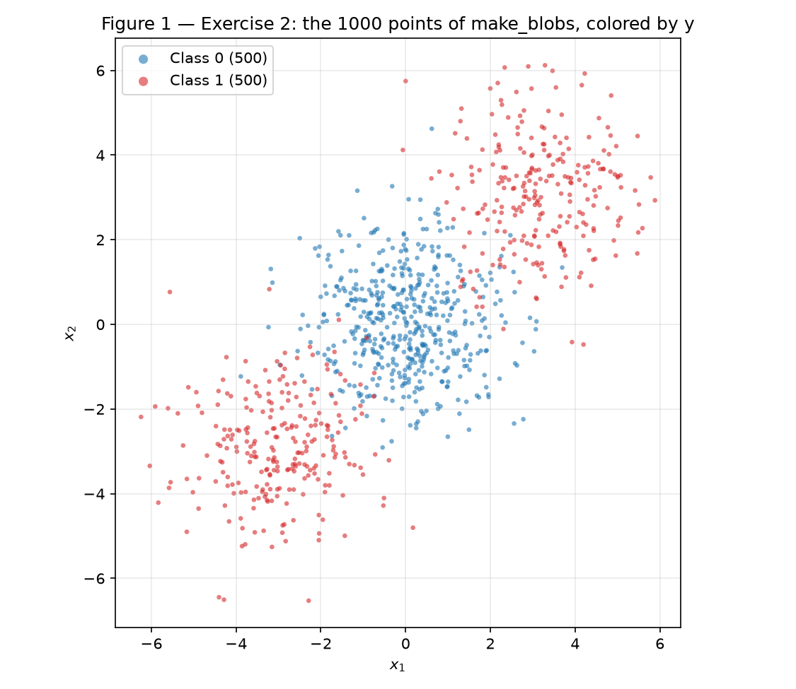
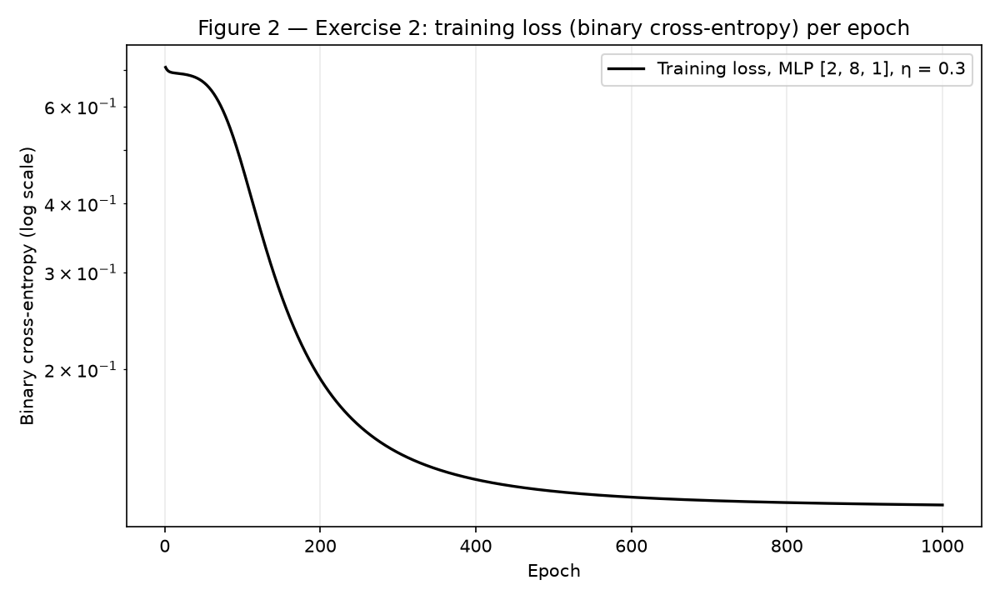
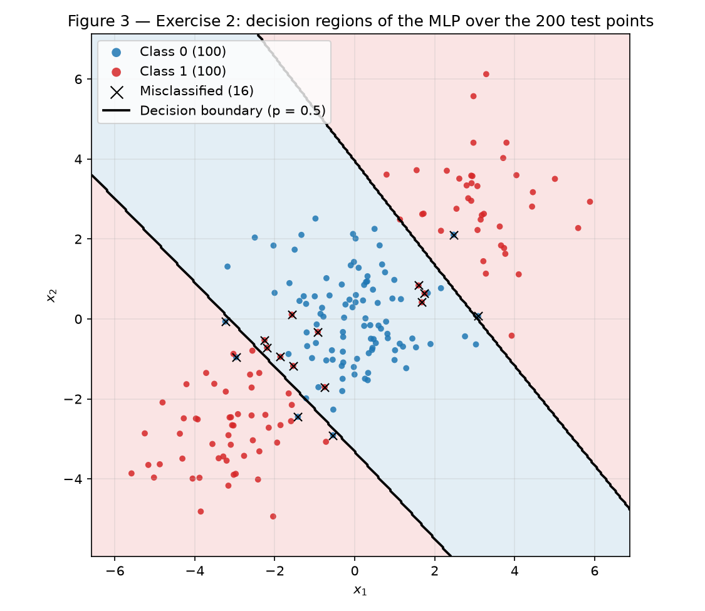
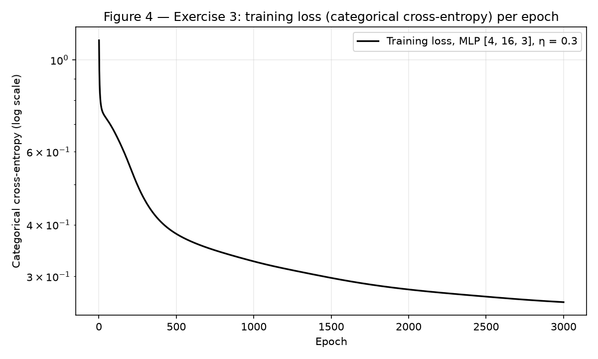
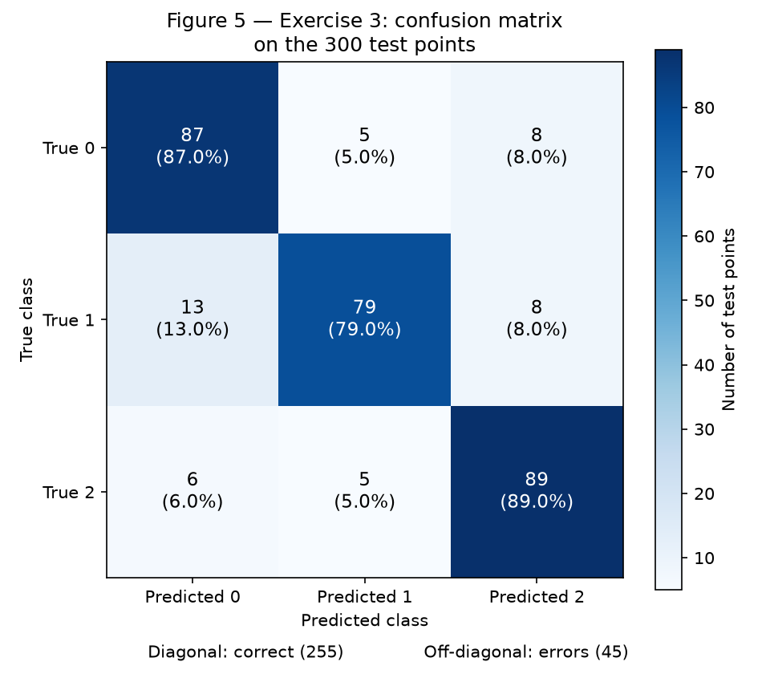
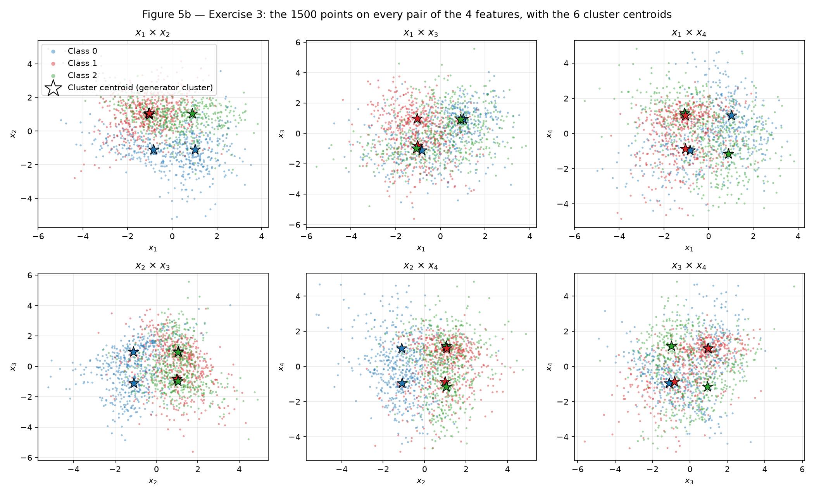
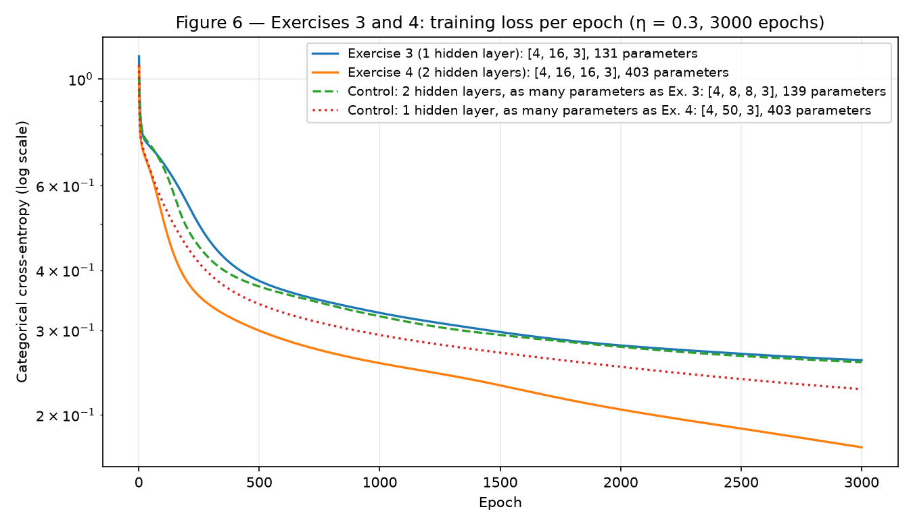
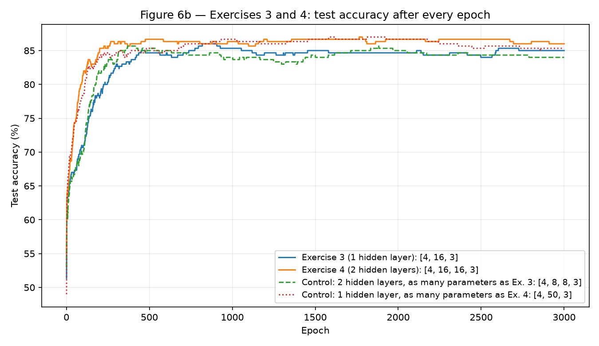

# 3. MLP

!!! abstract "Enunciado"

    [Exercises → MLP](https://insper.github.io/ann-dl/){:target='_blank'}

!!! info "Reprodutibilidade"

    Os dois conjuntos de dados e as divisões treino/teste vêm do scikit-learn com
    `random_state=42`, como o enunciado fixa. Todo o resto que é sorteado — os pesos iniciais
    de cada rede — vem de um único gerador, `rng = np.random.default_rng(42)`, criado uma vez
    no topo de `exercises.py`, sempre na mesma ordem: pesos do Ex. 1 (sorteados pelo
    construtor e logo sobrescritos pelos valores do enunciado) → pesos do Ex. 2 → pesos do
    Ex. 3 → pesos do Ex. 4 → pesos dos dois controles do Ex. 4. O treino é por gradiente em
    lote completo e não sorteia nada. A conferência de gradientes e o estudo de sementes do
    Ex. 4, item B, usam geradores próprios (`default_rng(0)` a `default_rng(4)`) e não alteram
    nenhum outro número. Rodando

    ```shell
    python docs/exercises/mlp/code/exercises.py
    ```

    a partir da raiz do repositório (cerca de 2 min), todos os números desta página são
    impressos (as versões das bibliotecas inclusive) e todas as figuras são regeradas em
    `figures/`. Os números foram obtidos com NumPy 2.5.3, scikit-learn 1.7.2 e
    Matplotlib 3.11.2; o NumPy não garante a mesma sequência
    de um `Generator` entre versões, então é com essas versões que eles se reproduzem
    exatamente.

O fio condutor da atividade é **o que uma camada escondida compra**. O Exercício 1 faz o
backpropagation à mão, uma vez, para ver cada um dos oito parâmetros se mover. O Exercício 2
dá à rede um problema que nenhuma reta resolve (a regressão logística acerta *menos* que o
acaso) e mostra a MLP passando de 90%. O Exercício 3 troca o problema por três classes sem
trocar uma linha do núcleo da implementação. E o Exercício 4 pergunta se empilhar uma segunda
camada escondida compra alguma coisa a mais — e a resposta medida é: nada que se distinga de
uma camada só com o mesmo número de parâmetros.

---

## Abordagem de implementação

O código está dividido em dois arquivos, ambos em `code/`:

| Arquivo | Conteúdo |
|---------|----------|
| `mlp.py` | Só o modelo: ativações, perdas, a classe `MLP` com `forward`, `backward`, `update` e o laço `fit`. Apenas NumPy. O único sorteio é a inicialização dos pesos, feita com o gerador que o chamador passa. |
| `exercises.py` | O gerador `rng`, a conferência numérica do Ex. 1 e dos gradientes, a geração dos dois conjuntos, as *baselines*, os treinos, os controles e o estudo de sementes do Ex. 4, as Figuras 1–6 (e as auxiliares 5b e 6b) e a impressão de todo número citado aqui. |

Decisões de implementação que afetam os resultados:

| Decisão | Escolha | Por quê |
|---------|---------|---------|
| Tamanhos das camadas | Uma lista, `layer_sizes`, no construtor | O mesmo código constrói `[2, 8, 1]` (Ex. 2), `[4, 16, 3]` (Ex. 3) e `[4, 16, 16, 3]` (Ex. 4). |
| Saída e perda | Um nome no construtor: `"sigmoid"` (entropia cruzada binária), `"softmax"` (entropia cruzada categórica) ou `"tanh"` (erro quadrático do Ex. 1) | Cada tipo de saída contribui só com uma função, $\partial L/\partial \mathbf{u}$ na saída. Para `"sigmoid"` e `"softmax"` ela é a **mesma** expressão, $(\mathbf{p} - \mathbf{y})/N$ (derivada no Ex. 3, item B), e é por isso que `backward` não precisa saber qual saída está servindo. |
| Ativação escondida | $\tanh$ em todas as camadas escondidas | É a do Ex. 1; a derivada $1 - h^2$ sai da própria ativação guardada no *forward*. |
| Treino | Gradiente em **lote completo**: um *forward*, um *backward* e uma atualização por época | Determinístico (nada é sorteado no treino), a curva de perda é lisa, e "mesmo orçamento de treino" no Ex. 4 significa literalmente as mesmas 3000 atualizações. |
| Entrada | Padronizada (média 0, desvio 1 por atributo) com estatísticas **do treino** | Deixa $\eta$ comparável entre os exercícios e evita que $\tanh$ comece saturada. |
| Inicialização | $W \sim \mathcal{N}(0,\ 1/n_{\text{in}})$, $b = 0$ | Mantém as pré-ativações na escala das entradas, para a $\tanh$ começar na região linear. |

!!! success "Reúso literal (ponto extra do Ex. 3)"

    O Exercício 3 usa a classe `MLP` **sem nenhuma alteração**: `forward`, `backward` e
    `update` são as mesmas linhas que rodaram no Exercício 2. O que muda está nos argumentos
    do construtor — `layer_sizes=[4, 16, 3]` e `output="softmax"` — e nos hiperparâmetros
    passados a `fit`. O trecho de `exercises.py` que treina o Ex. 3 (item C) deixa isso visível.

---

## Exercise 1

### A — Forward pass

Com $\mathbf{x} = [0{,}5;\ -0{,}2]$, $y = 1$ e os parâmetros dados:

$$
\mathbf{z}^{(1)} = \mathbf{W}^{(1)}\mathbf{x} + \mathbf{b}^{(1)}
= \begin{bmatrix} 0{,}3 \cdot 0{,}5 + (-0{,}1)(-0{,}2) + 0{,}1 \\ 0{,}2 \cdot 0{,}5 + 0{,}4 \cdot (-0{,}2) - 0{,}2 \end{bmatrix}
= \begin{bmatrix} 0{,}15 + 0{,}02 + 0{,}1 \\ 0{,}1 - 0{,}08 - 0{,}2 \end{bmatrix}
= \begin{bmatrix} \mathbf{0{,}2700} \\ \mathbf{-0{,}1800} \end{bmatrix}
$$

$$
\mathbf{h}^{(1)} = \tanh(\mathbf{z}^{(1)}) = \begin{bmatrix} \tanh(0{,}27) \\ \tanh(-0{,}18) \end{bmatrix}
= \begin{bmatrix} \mathbf{0{,}2636} \\ \mathbf{-0{,}1781} \end{bmatrix}
\quad (0{,}263625;\ -0{,}178081)
$$

$$
u^{(2)} = \mathbf{W}^{(2)} \mathbf{h}^{(1)} + b^{(2)}
= 0{,}5 \cdot 0{,}263625 + (-0{,}3)(-0{,}178081) + 0{,}2
= 0{,}131813 + 0{,}053424 + 0{,}2 = \mathbf{0{,}3852}
\quad (0{,}385237)
$$

$$
\hat{y} = \tanh(0{,}385237) = \mathbf{0{,}3672} \quad (0{,}367247),
\qquad
L = (y - \hat{y})^2 = (1 - 0{,}367247)^2 = 0{,}632753^2 = \mathbf{0{,}4004} \quad (0{,}400377)
$$

### B — Backward pass

Cada derivada é obtida pela regra da cadeia a partir da anterior; os valores usam seis
casas, para que as quatro pedidas fiquem corretas depois das contas.

**Saída.** De $L = (y - \hat{y})^2$,

$$
\frac{\partial L}{\partial \hat{y}} = -2\,(y - \hat{y}) = -2 \cdot 0{,}632753 = \mathbf{-1{,}265507} .
$$

Como $\hat{y} = \tanh(u^{(2)})$, $\dfrac{d\hat{y}}{du^{(2)}} = 1 - \hat{y}^2 = 1 - 0{,}134870 = 0{,}865130$, e

$$
\delta^{(2)} \equiv \frac{\partial L}{\partial u^{(2)}}
= \frac{\partial L}{\partial \hat{y}}\,(1 - \hat{y}^2)
= -1{,}265507 \cdot 0{,}865130 = \mathbf{-1{,}094828} .
$$

**Camada de saída.** $u^{(2)} = \sum_j W^{(2)}_j h^{(1)}_j + b^{(2)}$, logo
$\partial u^{(2)}/\partial W^{(2)}_j = h^{(1)}_j$ e $\partial u^{(2)}/\partial b^{(2)} = 1$:

$$
\frac{\partial L}{\partial \mathbf{W}^{(2)}} = \delta^{(2)}\, \mathbf{h}^{(1)}
= -1{,}094828 \cdot [0{,}263625;\ -0{,}178081]
= [\mathbf{-0{,}288624};\ \mathbf{0{,}194968}],
\qquad
\frac{\partial L}{\partial b^{(2)}} = \delta^{(2)} = \mathbf{-1{,}094828} .
$$

**Propagando para trás.** $u^{(2)}$ depende de $h^{(1)}_j$ através de $W^{(2)}_j$, então

$$
\frac{\partial L}{\partial \mathbf{h}^{(1)}} = \delta^{(2)}\, \mathbf{W}^{(2)}
= -1{,}094828 \cdot [0{,}5;\ -0{,}3]
= [\mathbf{-0{,}547414};\ \mathbf{0{,}328448}] .
$$

Como $h^{(1)}_j = \tanh(z^{(1)}_j)$, multiplica-se componente a componente por
$1 - (h^{(1)}_j)^2 = [1 - 0{,}069498;\ 1 - 0{,}031713] = [0{,}930502;\ 0{,}968287]$:

$$
\mathbf{\delta}^{(1)} \equiv \frac{\partial L}{\partial \mathbf{z}^{(1)}}
= \frac{\partial L}{\partial \mathbf{h}^{(1)}} \odot \left(1 - (\mathbf{h}^{(1)})^2\right)
= [-0{,}547414 \cdot 0{,}930502;\ 0{,}328448 \cdot 0{,}968287]
= [\mathbf{-0{,}509370};\ \mathbf{0{,}318032}] .
$$

**Camada escondida.** $z^{(1)}_i = \sum_j W^{(1)}_{ij} x_j + b^{(1)}_i$, logo
$\partial z^{(1)}_i / \partial W^{(1)}_{ij} = x_j$ (o gradiente é o produto externo
$\mathbf{\delta}^{(1)} \mathbf{x}^\top$) e $\partial z^{(1)}_i / \partial b^{(1)}_i = 1$:

$$
\frac{\partial L}{\partial \mathbf{W}^{(1)}} = \mathbf{\delta}^{(1)} \mathbf{x}^\top
= \begin{bmatrix} -0{,}509370 \cdot 0{,}5 & -0{,}509370 \cdot (-0{,}2) \\ 0{,}318032 \cdot 0{,}5 & 0{,}318032 \cdot (-0{,}2) \end{bmatrix}
= \begin{bmatrix} \mathbf{-0{,}254685} & \mathbf{0{,}101874} \\ \mathbf{0{,}159016} & \mathbf{-0{,}063606} \end{bmatrix},
\qquad
\frac{\partial L}{\partial \mathbf{b}^{(1)}} = \mathbf{\delta}^{(1)} = [\mathbf{-0{,}509370};\ \mathbf{0{,}318032}] .
$$

### C — Parameter update

Com $\eta = 0{,}3$, cada parâmetro anda $-\eta$ vezes o seu gradiente:

| Parâmetro | Valor | Gradiente | $-\eta \cdot$ gradiente | **Novo valor** |
|-----------|-------|-----------|-------------------------|----------------|
| $W^{(2)}_1$ | 0,5 | −0,288624 | +0,086587 | **0,586587** |
| $W^{(2)}_2$ | −0,3 | 0,194968 | −0,058490 | **−0,358490** |
| $b^{(2)}$ | 0,2 | −1,094828 | +0,328448 | **0,528448** |
| $W^{(1)}_{11}$ | 0,3 | −0,254685 | +0,076405 | **0,376405** |
| $W^{(1)}_{12}$ | −0,1 | 0,101874 | −0,030562 | **−0,130562** |
| $W^{(1)}_{21}$ | 0,2 | 0,159016 | −0,047705 | **0,152295** |
| $W^{(1)}_{22}$ | 0,4 | −0,063606 | +0,019082 | **0,419082** |
| $b^{(1)}_1$ | 0,1 | −0,509370 | +0,152811 | **0,252811** |
| $b^{(1)}_2$ | −0,2 | 0,318032 | −0,095410 | **−0,295410** |

(A tabela tem nove linhas porque $\mathbf{W}^{(1)}$ tem quatro entradas: os "oito
parâmetros" do enunciado são os quatro blocos $\mathbf{W}^{(1)}$, $\mathbf{b}^{(1)}$,
$\mathbf{W}^{(2)}$ e $b^{(2)}$, nove escalares no total — todos atualizados aqui.)

**A perda cai.** Num segundo *forward* com os parâmetros novos, $\hat{y} = 0{,}711181$ e
$L = 0{,}083417$, contra $0{,}400377$ antes. Dois motivos, um geral e um específico:

- *Geral.* O gradiente é a direção de maior crescimento de $L$; andar contra ele, com um
  passo pequeno o bastante, diminui $L$ — em primeira ordem,
  $\Delta L \approx -\eta\, \lVert \nabla L \rVert^2 \le 0$. Aqui
  $\lVert \nabla L \rVert^2 = 1{,}785$, o que prevê $\Delta L \approx -0{,}536$.
- *Específico.* A queda real foi $-0{,}317$: menor que a previsão linear, porque o passo não é
  pequeno — a previsão levaria $L$ a um valor negativo, impossível. O que amortece é a
  própria $\tanh$: $\hat{y}$ só pode crescer até 1, e, à medida que $u^{(2)}$ sobe, a derivada
  $1 - \hat{y}^2$ cai (de 0,865 para 0,494), de modo que o mesmo deslocamento em $u^{(2)}$ rende
  cada vez menos em $\hat{y}$. Todos os sinais apontam para o mesmo lado: $b^{(2)}$ sobe,
  $W^{(2)}_1$ cresce porque $h^{(1)}_1 > 0$ e $W^{(2)}_2$ fica mais negativo porque
  $h^{(1)}_2 < 0$ — tudo empurra $u^{(2)}$ e, com ele, $\hat{y}$ na direção de $y = 1$.

A conferência numérica, feita com a classe `MLP` carregada com estes parâmetros, reproduz
todos os números acima:

``` { .python .copy .select linenums='1' title="docs/exercises/mlp/code/exercises.py — conferência do Exercício 1" }
--8<-- "docs/exercises/mlp/code/exercises.py:ex1"
```

---

## Exercise 2

### A — Generate the data

**Abordagem.** Os parâmetros do enunciado, sem alteração: três *blobs* com
`random_state=42`, a do meio (500 pontos) vira a classe 0 e as duas das pontas (250 + 250)
viram a classe 1. Divisão 80/20 estratificada com a mesma semente.

| | Pontos | No treino | No teste | Média amostral |
|---|---|---|---|---|
| Classe 0 | 500 | 400 | 100 | $[0{,}0043;\ 0{,}0421]$ |
| Classe 1 | 500 | 400 | 100 | $[0{,}0753;\ 0{,}0947]$ — lobos em $[3{,}17;\ 3{,}09]$ e $[-3{,}02;\ -2{,}90]$ |

As médias das duas **classes** praticamente coincidem (ambas perto da origem): a classe 1 é
a união de dois lobos simétricos em relação ao centro da classe 0. Esse é o fato geométrico
que decide o item B.

``` { .python .copy .select linenums='1' title="docs/exercises/mlp/code/exercises.py — dados do Exercício 2" }
--8<-- "docs/exercises/mlp/code/exercises.py:data2"
```


/// caption
**Figura 1** — Os 1000 pontos de `make_blobs`, uma cor por classe. A classe 0 ocupa o centro;
a classe 1 está nos dois cantos opostos da diagonal, com a classe 0 entre eles.
///

### B — Establish the baseline

**Abordagem.** Uma regressão logística do scikit-learn sobre o treino — uma única reta, o
ponto de referência contra o qual a MLP é medida (não é o modelo da atividade).

``` { .python .copy .select linenums='1' title="docs/exercises/mlp/code/exercises.py — baseline linear" }
--8<-- "docs/exercises/mlp/code/exercises.py:baseline2"
```

| Quantidade | Valor |
|------------|-------|
| Acurácia no **teste** | **47,50%** (95 de 200) |
| Acurácia no treino | 52,75% |
| $\mathbf{w}$, $b$ | $[0{,}0296;\ 0{,}0015]$, $-0{,}0031$ — $\lVert \mathbf{w} \rVert = 0{,}0297$ |
| Probabilidades previstas no teste | todas entre **0,457 e 0,544** |
| Acerto por classe no teste | classe 0: 53 de 100 · classe 1: 42 de 100 |

Abaixo de 50%, como o enunciado antecipa. O item D explica por quê; aqui fica o registro do
que a reta é: quase vertical ($\mathbf{w}$ a 2,9° do eixo $x_1$), cruzando a diagonal em
$x_1 \approx 0{,}10$, e com pesos tão pequenos que o modelo nunca se afasta de $p = 0{,}5$.

### C — Implement the MLP

**Abordagem.** A classe `MLP`, abaixo, implementa tudo o que o enunciado pede à mão:

- **Forward.** Para cada camada, $\mathbf{U} = \mathbf{H}_{\text{ant}} \mathbf{W} + \mathbf{b}$;
  $\tanh$ nas camadas escondidas e a ativação de saída escolhida na última. Toda ativação é
  guardada para o *backward*.
- **Perda.** Entropia cruzada binária,
  $L = -\frac{1}{N}\sum_i \left[ y_i \log p_i + (1 - y_i)\log(1 - p_i) \right]$, com
  $p = \sigma(u)$.
- **Backward.** Na saída, $\delta = \partial L / \partial \mathbf{u} = (\mathbf{p} - \mathbf{y})/N$
  (derivação no Ex. 3, item B — vale igualmente para a sigmoide com a entropia binária). Daí,
  para cada camada $l$ de cima para baixo:
  $\partial L/\partial \mathbf{W}^{(l)} = \mathbf{H}_{l-1}^\top \mathbf{\delta}$,
  $\partial L/\partial \mathbf{b}^{(l)} = \sum_{\text{amostras}} \mathbf{\delta}$, e
  $\mathbf{\delta} \leftarrow (\mathbf{\delta}\, \mathbf{W}^{(l)\top}) \odot (1 - \mathbf{H}_{l-1}^2)$
  para a camada de baixo — exatamente as contas do Exercício 1, vetorizadas sobre as $N$
  amostras.
- **Atualização.** $\mathbf{W} \leftarrow \mathbf{W} - \eta\, \partial L/\partial \mathbf{W}$,
  idem para $\mathbf{b}$.

As linhas destacadas são as três funções que os Exercícios 3 e 4 reusam sem alteração.

``` { .python .copy .select linenums='1' hl_lines="110-122 129-144 147-151" title="docs/exercises/mlp/code/mlp.py" }
--8<-- "docs/exercises/mlp/code/mlp.py"
```

Para ter certeza de que o *backward* está certo antes de confiar em qualquer resultado, o
script compara cada gradiente com uma diferença finita central ($h = 10^{-6}$) em três redes
pequenas, uma por tipo de saída: `[3, 5, 1]` (sigmoide), `[4, 6, 5, 3]` (softmax, duas camadas
escondidas) e `[2, 3, 1]` (tanh). A maior discrepância, em qualquer peso ou viés, foi de
$8{,}1 \times 10^{-11}$, $2{,}4 \times 10^{-10}$ e $4{,}3 \times 10^{-11}$, respectivamente.

**Treino.**

``` { .python .copy .select linenums='1' title="docs/exercises/mlp/code/exercises.py — treino do Exercício 2" }
--8<-- "docs/exercises/mlp/code/exercises.py:train2"
```

| Quantidade | Valor |
|------------|-------|
| Arquitetura | **[2, 8, 1]**: 2 entradas, 8 unidades $\tanh$, 1 saída sigmoide — 33 parâmetros |
| Taxa de aprendizado | $\eta = 0{,}3$ (lote completo, 800 amostras por passo) |
| Épocas | **1000** |
| Perda no treino | 0,7069 na época 1 → **0,1136** após a última atualização |
| Acurácia no treino | 96,38% |
| Acurácia no **teste** | **92,00%** (184 de 200): classe 0, 94 de 100; classe 1, 90 de 100 |

Dentro da faixa de 90–93% que o enunciado anuncia.


/// caption
**Figura 2** — Entropia cruzada binária no treino a cada época (escala log). A queda rápida
nas primeiras ~100 épocas é a rede encontrando a faixa da classe 0; o que vem depois é ajuste
fino das bordas.
///


/// caption
**Figura 3** — A rede avaliada numa grade de 400 × 400 pontos: cada região tingida pela
classe prevista, a fronteira $p = 0{,}5$ em preto, e os 200 pontos de teste por cima, com os
16 errados marcados. A classe 0 recebe uma **faixa diagonal**; a classe 1, os dois lados de
fora dela.
///

### D — Analysis

**A forma da região.** Na Figura 3, a região que a rede atribui à classe 1 é **tudo o que
está fora de uma faixa diagonal**: duas peças desconexas, uma em cada lado da faixa, com a
classe 0 no meio. O script mede isso percorrendo a diagonal $x_1 = x_2$ de $-8$ a $8$: a
predição começa em 1, vira 0 em $t = -1{,}61$ e volta a 1 em $t = 1{,}71$ — **duas trocas de
classe** numa única reta. Ao longo da antidiagonal $x_1 = -x_2$ não há troca nenhuma (é
sempre classe 0): a faixa é paralela a ela.

**Por que uma reta não produz isso.** Uma reta divide o plano em dois semiplanos, e um
semiplano é convexo: se contém dois pontos, contém o segmento entre eles. Os centros dos dois
lobos da classe 1 estão em $[3{,}17;\ 3{,}09]$ e $[-3{,}02;\ -2{,}90]$, e o ponto médio do
segmento que os liga, $[0{,}08;\ 0{,}09]$, praticamente coincide com o centro da classe 0,
$[0{,}00;\ 0{,}04]$ (nos centros do gerador a coincidência é exata). Então qualquer reta que
deixe os dois lobos do lado "classe 1" deixa também a nuvem inteira da classe 0 desse lado.
Para acertar as duas classes, a região da classe 1 precisa ter *duas* peças, e um semiplano
tem uma só. Isso prova que nenhuma reta **separa** as classes — não que uma reta esteja presa
a 50%. Uma reta pode acertar um lobo inteiro e a classe 0 inteira, errando só o outro lobo:
o script procura por força bruta a reta de maior acurácia no treino (720 direções, todos os
limiares) e encontra uma reta quase perpendicular à diagonal (normal a 39,8° do eixo $x_1$),
passando a 2,47 da origem, entre a classe 0 e o lobo de cima: ela acerta **74,25%** no treino
e **68,50%** no teste. Esse é o teto de *uma reta escolhida pela acurácia* — "um pouco menos que a MLP",
não o acaso.

**Por que a regressão logística fica em ≈ 50%, e não nos 70%.** Porque ela não escolhe a
reta pela acurácia: maximiza a verossimilhança, e as duas coisas aqui discordam. A reta de
74% precisa chamar de classe 0, com confiança, os 200 pontos de treino do lobo errado — e
cada um deles custa caro na entropia cruzada. O script confere: ao longo *dessa* reta, o
menor *log-loss* que qualquer escala de confiança alcança é 0,6927, **pior** que o da
regressão logística (0,6924) e praticamente igual ao de um modelo que diz $p = 0{,}5$ para
todos ($\ln 2 = 0{,}6931$). Pela simetria dos dados (os dois lobos são espelhados em torno do
centro da classe 0), o que uma direção ganha de verossimilhança num lobo ela paga no outro,
e o ótimo de verossimilhança é a reta degenerada: $\lVert \mathbf{w} \rVert = 0{,}03$,
probabilidades todas entre 0,46 e 0,54, um ganho de 0,0007 sobre o modelo constante. Um
modelo a um fio do acaso oscila em torno de 50% de amostra para amostra: no treino deu
52,75%, no teste 47,50%. Com 200 pontos, o desvio-padrão da acurácia de uma moeda é
$\sqrt{0{,}25/200} = 3{,}5$ pontos percentuais; 47,5% está a menos de um desvio de 50%. O
"abaixo de 50%" não é a reta *aprendendo errado*: é a melhor reta pela verossimilhança não
tendo nada a dizer, e a amostra de teste caindo do lado de baixo.

**Por que a MLP passa de 90%.** A faixa da Figura 3 é a interseção de dois semiplanos:
$x_1 + x_2 > -a$ **e** $x_1 + x_2 < b$. Uma unidade escondida com $\tanh$ é, na prática, um
semiplano suavizado; duas delas, com sinais opostos ao longo da diagonal, dão os dois lados
da faixa, e a unidade de saída só precisa combiná-las (um "E" lógico, que uma soma com pesos
e um limiar faz). A camada escondida transforma as coordenadas de modo que, *nas novas
coordenadas*, a classe 1 vira linearmente separável — é isso que a reta sozinha não pode
fazer. Os 8% de erro que sobram (16 pontos, quase todos na borda da faixa e os demais
dentro da nuvem da classe 0) são a sobreposição real
das nuvens, com desvio 1,2 e centros a $3\sqrt{2} = 4{,}2$ de distância: ali não há fronteira
de nenhuma forma que acerte tudo.

---

## Exercise 3

### A — Generate the data

**Abordagem.** O `make_classification` do enunciado, sem alteração, e a mesma divisão 80/20
estratificada com `random_state=42`. A função também recupera de qual dos 6 aglomerados do
gerador cada ponto veio (o gerador constrói os aglomerados em ordem e só embaralha no fim;
gerar de novo com `shuffle=False` e casar as linhas recupera a ordem) — isso não entra no
treino, só na análise do item D.

``` { .python .copy .select linenums='1' title="docs/exercises/mlp/code/exercises.py — dados do Exercício 3" }
--8<-- "docs/exercises/mlp/code/exercises.py:data3"
```

| | Total | Treino | Teste |
|---|---|---|---|
| Pontos | 1500 | 1200 | 300 |
| Por classe (0 / 1 / 2) | 499 / 499 / 502 | 399 / 399 / 402 | 100 / 100 / 100 |

Quatro atributos informativos, sem redundantes nem repetidos; desvios-padrão por atributo
entre 1,47 e 1,64. Pelo desenho do gerador, cada classe é a união de **dois** aglomerados de
250 pontos, seis no total, centrados em vértices de um hipercubo $\{-1, +1\}^4$ (lado
$2 \cdot$ `class_sep` $= 2$), cada um deformado por uma transformação linear própria; além
disso, `flip_y=0.01` (padrão) sorteia um rótulo novo para 1% dos pontos — 11 dos 1500
ficaram com o rótulo trocado. É a estrutura que o item D usa.

### B — Adapt the network

**O que muda.** Três coisas, todas argumentos do construtor ou de `fit`, nenhuma no código:

| | Exercício 2 | Exercício 3 |
|---|---|---|
| Camada de saída | 1 unidade | **3 unidades** (`layer_sizes=[4, 16, 3]`) |
| Ativação de saída | sigmoide | **softmax**: $p_k = e^{u_k} / \sum_j e^{u_j}$ |
| Perda | entropia cruzada binária | **entropia cruzada categórica**: $L = -\frac{1}{N}\sum_i \sum_k y_{ik} \log p_{ik}$, com $\mathbf{y}_i$ *one-hot* |

**Derivação de $\partial L / \partial \mathbf{u}$ para softmax + entropia cruzada.** Para uma
amostra (o $1/N$ só multiplica no fim), com $\mathbf{y}$ *one-hot* ($\sum_k y_k = 1$):

$$
L = -\sum_k y_k \log p_k, \qquad p_k = \frac{e^{u_k}}{\sum_j e^{u_j}} .
$$

Primeiro a derivada do softmax. Para $k = i$,

$$
\frac{\partial p_i}{\partial u_i}
= \frac{e^{u_i} \sum_j e^{u_j} - e^{u_i} e^{u_i}}{\left(\sum_j e^{u_j}\right)^2}
= p_i - p_i^2 = p_i (1 - p_i),
$$

e para $k \neq i$,

$$
\frac{\partial p_k}{\partial u_i}
= \frac{0 - e^{u_k} e^{u_i}}{\left(\sum_j e^{u_j}\right)^2}
= -p_k\, p_i .
$$

As duas juntas: $\partial p_k / \partial u_i = p_k (\delta_{ki} - p_i)$, com $\delta_{ki}$ o
delta de Kronecker. Pela regra da cadeia,

$$
\frac{\partial L}{\partial u_i}
= \sum_k \frac{\partial L}{\partial p_k} \frac{\partial p_k}{\partial u_i}
= \sum_k \left(-\frac{y_k}{p_k}\right) p_k (\delta_{ki} - p_i)
= -\sum_k y_k (\delta_{ki} - p_i)
= -y_i + p_i \sum_k y_k
= p_i - y_i .
$$

Os $p_k$ do denominador cancelam com os do numerador, e $\sum_k y_k = 1$ elimina a soma. Com a
média sobre $N$ amostras:

$$
\boxed{\ \frac{\partial L}{\partial \mathbf{u}} = \frac{\mathbf{p} - \mathbf{y}}{N}\ }
$$

É o mesmo resultado da sigmoide com a entropia cruzada binária (que é o caso $K = 2$ escrito
com uma unidade só: $\partial L/\partial u = p - y$, pois $\sigma' = \sigma(1 - \sigma)$
cancela o $1/[p(1-p)]$ da perda). A simplicidade não é coincidência: a entropia cruzada é
exatamente a perda cuja derivada "desfaz" a saturação do softmax — o gradiente é o erro cru
$\mathbf{p} - \mathbf{y}$, grande quando a rede erra com confiança, e não vai a zero quando a
saída satura (o que aconteceria com o erro quadrático, cuja derivada carrega o fator
$p(1-p)$). **É por isso que o `backward` da classe `MLP` é o mesmo para os dois exercícios**:
a única coisa que a saída entrega ao *backward* é esse $\mathbf{\delta}$, e ele é o mesmo
nos dois casos (`delta_cross_entropy`, em `mlp.py`).

### C — Train and evaluate

O trecho que treina é o mesmo `fit` do Exercício 2, chamado com outros argumentos; a função
abaixo é reusada, sem mudança, pelo Exercício 4 (daí os parâmetros `layer_sizes` e
`generator`).

``` { .python .copy .select linenums='1' title="docs/exercises/mlp/code/exercises.py — treino dos Exercícios 3 e 4" }
--8<-- "docs/exercises/mlp/code/exercises.py:train3"
```

| Quantidade | Valor |
|------------|-------|
| Arquitetura | **[4, 16, 3]**: 4 entradas, 16 unidades $\tanh$, 3 saídas softmax — 131 parâmetros |
| Hiperparâmetros | $\eta = 0{,}3$, **3000 épocas**, lote completo (1200 amostras), entrada padronizada |
| Perda no treino | 1,1153 na época 1 → **0,2600** após a última atualização |
| Acurácia no treino | 90,58% |
| Acurácia no **teste** | **85,00%** (255 de 300) |
| Por classe (teste) | classe 0: 87 de 100 · classe 1: 79 de 100 · classe 2: 89 de 100 |

Dentro dos 83–86% esperados.


/// caption
**Figura 4** — Entropia cruzada categórica no treino a cada época (escala log). Diferente da
Figura 2, a curva não se achata: segue caindo devagar até a época 3000, enquanto a acurácia
no teste já está estável desde a época ~500 (Figura 6b, no Exercício 4).
///


/// caption
**Figura 5** — Matriz de confusão nos 300 pontos de teste (linhas: classe verdadeira). A
diagonal soma 255. Fora dela, o maior número é o 13 de pontos da classe 1 chamados de
classe 0.
///

### D — Analysis

**O par mais confundido: classes 0 e 1.** Somando as duas direções da Figura 5:

| Par | Confusões (ida + volta) |
|-----|-------------------------|
| **0 ↔ 1** | **18** (5 + 13) |
| 0 ↔ 2 | 14 (8 + 6) |
| 1 ↔ 2 | 13 (8 + 5) |

A diferença para os outros pares é de poucos pontos, então vale conferir se ela é de
verdade ou sorte da inicialização: nas 5 sementes do estudo do Exercício 4 (item B), com a
mesma arquitetura, o par 0 ↔ 1 foi o mais confundido em **4 de 5** — e em 5 de 6 contando
esta execução; somando as cinco matrizes de confusão, 0 ↔ 1 acumula 91 erros, contra 81 de
1 ↔ 2 e 58 de 0 ↔ 2. A direção também: é a classe 1 que vaza para a classe 0 (13 pontos
nesta execução, 59 nas 5 sementes somadas), não o contrário (5 e 32).

**A estrutura dos aglomerados.** Como o gerador constrói os 6 aglomerados em ordem e só
depois embaralha, o script recupera de qual aglomerado cada ponto veio (item A) e mede, no
treino, o que importa:

| Aglomerado | Classe | Centroide (sinais → vértice) | Pontos no treino | Raio RMS |
|---|---|---|---|---|
| 0 | 0 | $[-0{,}84;\ -1{,}09;\ -1{,}12;\ -0{,}95]$ → `−−−−` | 199 | 2,48 |
| **1** | **1** | $[-1{,}03;\ +0{,}99;\ -0{,}82;\ -0{,}87]$ → `−+−−` | 201 | **2,77** |
| 2 | 2 | $[-1{,}07;\ +1{,}04;\ -0{,}99;\ +1{,}16]$ → `−+−+` | 204 | 2,49 |
| 3 | 0 | $[+1{,}02;\ -1{,}10;\ +0{,}96;\ +1{,}02]$ → `+−++` | 201 | 2,46 |
| 4 | 1 | $[-1{,}03;\ +1{,}06;\ +0{,}98;\ +1{,}04]$ → `−+++` | 201 | 1,79 |
| 5 | 2 | $[+0{,}89;\ +1{,}04;\ +0{,}93;\ -1{,}16]$ → `+++−` | 194 | 2,44 |

Os centroides caem, como o gerador promete, em vértices $\pm 1$; os seis aglomerados têm o
mesmo tamanho (250 pontos cada, ≈ 200 no treino), então nenhum tem "maioria" a priori. O que
varia é a forma: a transformação linear sorteada por aglomerado dá raios RMS de 1,79 a 2,77
e desvios ao longo das retas entre centros de 0,57 a 1,85. Três fatos saem da tabela:

1. **Os aglomerados são maiores que a distância entre eles.** Dois vértices vizinhos do
   hipercubo (que diferem num só sinal) estão a 2 de distância; os três pares vizinhos de
   classes diferentes medem 1,98, 2,03 e 2,10 — e o desvio-padrão dentro dos aglomerados é
   de 1,04 a 1,25 por atributo. Dois centros a 2 de distância com desvios ≈ 1,2 de cada lado
   se sobrepõem fortemente; a sobreposição é a fonte de *todo* o erro restante, e é por isso
   que nenhuma arquitetura passa muito de 86% aqui (Exercício 4).
2. **Só três pares de classes diferentes são vizinhos de um sinal**: 2–4 (classes 2–1,
   distância 1,98), 1–2 (classes 1–2, 2,03) e 0–1 (classes **0–1**, 2,10). O aglomerado 1 da
   classe 1 (`−+−−`) está em dois deles: é vizinho de um aglomerado da classe 0 e de um da
   classe 2. Todos os pares entre as classes 0 e 2 diferem em dois sinais ou mais (os mais
   próximos a 3,01 e 3,06); no acumulado das 5 sementes, 0 ↔ 2 é o par *menos* confundido
   (58, contra 81 e 91 — nesta execução, 14 contra 13 de 1 ↔ 2, empate técnico).
3. **O aglomerado 1 é o culpado, e é o mais difuso.** Ele perde **16 dos seus 49** pontos de
   teste (33%): 11 vão para a classe 0 e 5 para a classe 2. Nenhum outro aglomerado perde mais
   de 9. É o aglomerado de maior raio (2,77, contra 1,79–2,49 dos outros), e, ao longo das
   retas que o ligam aos dois vizinhos, o seu desvio é 1,25 (rumo ao aglomerado 0, classe 0)
   e 1,31 (rumo ao aglomerado 2, classe 2) — em ambos os casos mais da metade da distância
   de ≈ 2 entre os centros. Ele simplesmente transborda para os dois lados. Que transborde
   *mais* para a classe 0 (11 × 5) é o que decide o par 0 ↔ 1 sobre 1 ↔ 2: 11 dos 13 erros
   "1 → 0" vêm dele. Os três pares vizinhos são geometricamente equivalentes (todos a ≈ 2),
   então nada no desenho dos vértices prevê 0 ↔ 1 em vez de 1 ↔ 2 — e os desvios ao longo
   das retas entre centros também não (o aglomerado 1 é até um pouco mais largo rumo ao
   aglomerado 2, 1,31, do que rumo ao 0, 1,25). O lado para o qual ele vaza mais (11 × 5) é
   um fato empírico, estável entre as sementes (91 contra 81 no acumulado), que essas medidas
   unidimensionais não preveem; a diferença entre os dois pares é de 5 pontos de teste.


/// caption
**Figura 5b** — Os quatro atributos dois a dois, uma cor por classe, e as estrelas nos
centroides dos aglomerados do gerador. No painel $x_1 \times x_2$ as duas estrelas azuis
(classe 0) estão em $x_2 \approx -1$ e as outras quatro em $x_2 \approx +1$: um único corte
em $x_2$ já separa grosso modo a classe 0 (83% de acerto classe-0-contra-o-resto). As duas
estrelas vermelhas (classe 1) quase coincidem nesse painel — os seus aglomerados diferem em
$x_3$ e $x_4$ — e a estrela verde que coincide com elas (aglomerado 2 da classe 2, `−+−+`)
está a um sinal de cada uma: é entre as classes 1 e 2 que uma direção única funciona mal.
///

**A baseline linear e o que a camada escondida comprou.** A regressão logística
(multinomial, scikit-learn) acerta **66,33%** no teste (199 de 300), os ≈ 66% do enunciado,
contra 85,00% da MLP: **+18,67 pontos percentuais**, 56 pontos de teste a mais. A matriz de
confusão da baseline conta onde ela falha:

| Verdadeira ↓ / Prevista → | 0 | 1 | 2 |
|---|---|---|---|
| 0 | 80 | 11 | 9 |
| 1 | 11 | **57** | **32** |
| 2 | 13 | **25** | **62** |

A reta acerta razoavelmente a classe 0 (80 de 100) e confunde 1 ↔ 2 em **57** pontos (a
MLP: 13). A tabela de vértices explica os dois lados. Os dois aglomerados da classe 0
compartilham $x_2 = -1$, e os quatro aglomerados das outras classes têm $x_2 = +1$: a regra
"classe 0 se $x_2 < 0$", sozinha, acerta 83,33% de classe-0-contra-o-resto no teste — uma
direção basta para a classe 0, e um modelo linear a encontra. Já as classes 1 e 2 têm as
duas $x_2 = +1$; a classe 1 ocupa `−+−−` e `−+++`, e o aglomerado `−+−+` da classe 2 está a
um sinal de cada um deles, enquanto o outro aglomerado da classe 2, `+++−`, está do lado
oposto em $x_1$. Existe direção que deixe os dois vértices da classe 1 de um lado e os dois
da classe 2 do outro, mas com uma margem pequena — uma fração do desvio ≈ 1,2 dentro dos
aglomerados, enquanto o corte em $x_2$ deixa os vértices da classe 0 a 1 de distância do
hiperplano. Na prática, um modelo linear quase não distingue as duas classes: as médias
delas ficam a só **0,92** de distância (contra 2,37 e 2,13 dos outros pares), porque a média
de cada classe cai *entre* os seus dois aglomerados, longe dos dois centros, e um modelo
linear só enxerga uma direção por classe. A camada escondida de 16 unidades $\tanh$ comprou o que no Exercício 2
comprou: regiões de decisão com **mais de uma peça** por classe — um pedaço em torno de cada
aglomerado — e é isso que levou 1 ↔ 2 de 57 confusões para 13.

---

## Exercise 4

### A — Train the deeper network

**Abordagem.** Mesmos dados, mesma divisão, mesmo $\eta = 0{,}3$, mesmas 3000 épocas, mesma
padronização, mesmo gerador (continuando a sequência). A **única** mudança é a lista de
tamanhos: uma segunda camada escondida com a mesma largura, `[4, 16, 16, 3]`. A função de
treino é a mesma do Exercício 3, chamada com a lista nova.

| Quantidade | Valor |
|------------|-------|
| Arquitetura | **[4, 16, 16, 3]**: duas camadas escondidas de 16 unidades $\tanh$ — 403 parâmetros |
| Hiperparâmetros | iguais ao Ex. 3: $\eta = 0{,}3$, 3000 épocas, lote completo |
| Perda no treino | **0,1713** após a última atualização (Ex. 3: 0,2600) |
| Acurácia no treino | 94,33% (Ex. 3: 90,58%) |
| Acurácia no **teste** | **86,00%** (258 de 300; Ex. 3: 85,00%) |
| Par mais confundido | ainda 0 ↔ 1 (19 confusões: 12 na direção 1 → 0 e 7 na direção 0 → 1) |

Um ponto percentual a mais — **3 pontos de teste** — nesta execução. O item B mede se isso é
modelo ou sorte.

### B — Compare

``` { .python .copy .select linenums='1' title="docs/exercises/mlp/code/exercises.py — Exercício 4" }
--8<-- "docs/exercises/mlp/code/exercises.py:ex4"
```

Acrescentar uma camada de 16 unidades triplica o número de parâmetros (131 → 403), então a
comparação pedida muda duas coisas ao mesmo tempo: profundidade e tamanho. Para separá-las, o
script treina dois **controles**, com tudo o mais igual: `[4, 8, 8, 3]`, duas camadas
escondidas com **139** parâmetros (≈ o tamanho da rede do Ex. 3, 131), e `[4, 50, 3]`, uma camada
escondida com exatamente **403** parâmetros (o tamanho da rede do Ex. 4).


/// caption
**Figura 6** — As curvas de perda de treino das quatro redes nos mesmos eixos (escala log): a
do Exercício 3 (1 camada escondida, 131 parâmetros), a do Exercício 4 (2 camadas, 403), e os
dois controles — 2 camadas com 139 parâmetros (tracejada) e 1 camada com 403 (pontilhada). As
duas redes de ~135 parâmetros são indistinguíveis a partir da época ~800; as duas de 403
descem mais, e a profunda mais que a larga.
///

**Execução principal** (gerador 42):

| | Camadas escondidas | Parâmetros | Perda final no treino | Acurácia no treino | **Acurácia no teste** |
|---|---|---|---|---|---|
| Exercício 3 `[4, 16, 3]` | 1 | 131 | 0,2600 | 90,58% | **85,00%** |
| Exercício 4 `[4, 16, 16, 3]` | 2 | 403 | 0,1713 | 94,33% | **86,00%** |
| Controle `[4, 8, 8, 3]` | 2 | 139 | 0,2575 | 90,42% | **84,00%** |
| Controle `[4, 50, 3]` | 1 | 403 | 0,2263 | 92,50% | **85,33%** |

**Média sobre 5 sementes** (geradores 0 a 4, tudo o mais fixo; as quatro redes de cada
semente tiram os pesos iniciais do mesmo gerador):

``` { .python .copy .select linenums='1' title="docs/exercises/mlp/code/exercises.py — estudo de sementes" }
--8<-- "docs/exercises/mlp/code/exercises.py:seeds"
```

| | Camadas escondidas | Parâmetros | Perda final no treino (média) | Acurácia no treino (média) | Acurácia no teste por semente | **Média** (desvio) |
|---|---|---|---|---|---|---|
| Exercício 3 `[4, 16, 3]` | 1 | 131 | 0,2733 | 90,15% | 84,67 · 85,00 · 84,33 · 85,33 · 84,00 | **84,67%** (0,53 pp) |
| Exercício 4 `[4, 16, 16, 3]` | 2 | 403 | 0,1853 | 93,43% | 86,00 · 85,00 · 85,00 · 84,67 · 85,67 | **85,27%** (0,55 pp) |
| Controle `[4, 8, 8, 3]` | 2 | 139 | 0,2661 | 89,92% | 84,33 · 84,33 · 85,67 · 83,67 · 84,67 | **84,53%** (0,73 pp) |
| Controle `[4, 50, 3]` | 1 | 403 | 0,2226 | 92,18% | 85,33 · 85,00 · 85,33 · 85,33 · 85,33 | **85,27%** (0,15 pp) |

Como as quatro redes de uma semente são avaliadas nos mesmos 300 pontos de teste, a
comparação certa é **pareada**, semente a semente:

| Diferença de acurácia no teste | Por semente (pp) | Média | Desvio | Erro-padrão | $t$ (4 g.l.) |
|---|---|---|---|---|---|
| Ex. 4 `[4, 16, 16, 3]` − Ex. 3 `[4, 16, 3]` | +1,33 · 0,00 · +0,67 · −0,67 · +1,67 | **+0,60** | 0,95 | 0,43 | 1,41 |
| `[4, 8, 8, 3]` − Ex. 3 (2 camadas, mesmo tamanho) | −0,33 · −0,67 · +1,33 · −1,67 · +0,67 | **−0,13** | 1,17 | 0,52 | −0,26 |
| `[4, 50, 3]` − Ex. 3 (1 camada, 3× parâmetros) | +0,67 · 0,00 · +1,00 · 0,00 · +1,33 | **+0,60** | 0,60 | 0,27 | 2,25 |
| Ex. 4 − `[4, 50, 3]` (mesmos 403 parâmetros, 2 camadas × 1) | +0,67 · 0,00 · −0,33 · −0,67 · +0,33 | **0,00** | 0,53 | 0,24 | 0,00 |

### C — Analysis

**O resultado: a segunda camada não compra nada que se meça.** A rede do Exercício 4 fica
$+0{,}60$ pp acima da do Exercício 3 em média — **menos de 2 pontos de teste em 300** —, com
$t = 1{,}41$ em 4 graus de liberdade (a diferença troca de sinal entre sementes: ganha em 3,
empata em 1, perde em 1). Isso não é distinguível de zero. E os dois controles dizem de onde
vem o pouco que há:

- com **duas camadas e o tamanho da rede rasa** (`[4, 8, 8, 3]`), a diferença é $-0{,}13$ pp:
  profundidade sem parâmetros extras não ajuda (e esse controle também estreita as camadas,
  de 16 para 8, o que o deixa, se algo, em desvantagem);
- com **uma camada e o tamanho da rede profunda** (`[4, 50, 3]`), a diferença é $+0{,}60$ pp —
  exatamente a mesma média da rede profunda, 85,27%; e a comparação direta entre as duas
  redes de 403 parâmetros dá **0,00 pp**.

Ou seja: o que a rede de `[4, 16, 16, 3]` ganha, uma rede rasa com o mesmo número de
parâmetros ganha igual. A profundidade, em si, não contribuiu nada. (O que o estudo de
sementes mede é a variação de inicialização; os 300 pontos de teste são os mesmos em todas
as execuções, então a incerteza de amostragem do teste — $\sqrt{0{,}85 \cdot 0{,}15/300} =
2{,}1$ pp para uma acurácia isolada — fica por fora, e só reforça a conclusão.)

**A perda de treino conta outra história — e é isso que importa.** Na Figura 6 (execução
principal), a rede profunda termina em 0,171 de perda contra 0,260 da rasa; nas médias das
5 sementes, 0,185 contra 0,273 de perda e 93,4% contra 90,2% de acurácia no treino: ela
*ajusta* o treino visivelmente melhor. Mas 3,3 pp a mais de acurácia no treino
viraram 0,6 pp no teste, e a folga treino–teste cresceu de 5,5 para 8,2 pp. A Figura 6b
mostra o descasamento no tempo: a acurácia de teste das quatro redes sobe até a época ~500 e
depois **para** entre 83% e 87%, enquanto as perdas de treino seguem caindo até a época 3000.
A partir dali, o que a perda mede é a rede aprendendo os pontos individuais da região de
sobreposição — ruído, não estrutura. As redes de 403 parâmetros têm mais capacidade para
fazer isso, e é só isso que a sua perda menor significa.


/// caption
**Figura 6b** — Acurácia no teste depois de cada época, para as mesmas quatro redes da
Figura 6. As quatro estabilizam na mesma faixa antes da época 500; as perdas de treino da
Figura 6 continuam caindo por mais 2500 épocas sem efeito aqui.
///

**Por que, pela estrutura dos dados.** O conjunto tem 6 aglomerados aproximadamente
gaussianos em 4 dimensões, de 250 pontos cada (Ex. 3, item D). A fronteira ótima entre duas
gaussianas de covariâncias diferentes é quadrática — e a fronteira ótima do problema inteiro
é uma colagem de poucas superfícies quadráticas em torno de 6 centros. Uma camada de 16
unidades $\tanh$ já tem de sobra para isso: cada unidade é um semiespaço suavizado, e uma
combinação de 16 deles desenha 6 regiões num espaço de 4 dimensões com folga. Não há nada
"para compor": o que limita a acurácia não é a forma da fronteira, e sim a **sobreposição**
— centros vizinhos a ≈ 2 de distância com desvios de ≈ 1,2 de cada lado. Nessa região a
classe de um ponto é genuinamente incerta, e nenhum modelo, por mais fundo, decide melhor
que a razão de verossimilhança local. (O `flip_y` ainda trocou o rótulo de 11 pontos em 1500
— 2 deles no teste, ambos errados pela rede do Ex. 3.) A rede rasa já está encostada nesse
teto; a profunda só pode gastar a capacidade extra decorando o treino.

**Representação versus otimização.** O que uma segunda camada acrescenta é a capacidade de
*compor* fronteiras: funções da primeira camada entram como entrada da segunda, e
fronteiras que uma camada só aproxima com muitas unidades uma segunda camada escreve com
poucas. Aqui isso não é necessário — a fronteira é simples. O custo, por outro lado, é
concreto: 3 vezes mais parâmetros, mais que o dobro do tempo de treino (o script imprime os
dois tempos; nas execuções que fiz a razão ficou entre 2,3 e 2,7, e depende da máquina), um
gradiente que atravessa duas $\tanh$ (com $\eta = 0{,}3$ e a inicialização
em $1/n_{\text{in}}$ não houve problema de otimização — a rede profunda desceu *mais rápido*
nas primeiras épocas, 0,514 contra 0,671 na época 100 — mas é o tipo de coisa que, em redes
mais fundas, vira o problema do gradiente que some), e uma folga maior para sobreajustar: a
distância treino–teste de 8,2 pp contra 5,5 pp.

**Que dados pagariam a profundidade.** Dados cuja estrutura seja **composicional**: em que
a classe depende de combinações de características que, por sua vez, dependem de combinações
de atributos. Exemplos:

- *Imagens*: a classe depende de objetos, que são arranjos de partes, que são arranjos de
  bordas — cada camada captura um nível, e uma camada só precisaria de uma unidade para cada
  objeto em cada posição.
- *Fronteiras com muitas dobras* (as duas espirais com muitas voltas, regiões em anéis
  concêntricos, funções oscilantes): os resultados de separação por profundidade mostram
  funções que uma rede funda representa com poucos neurônios por camada enquanto uma rede
  rasa precisa de um número exponencial deles — Telgarsky (2016) separa profundidade
  $\Theta(k^3)$ de profundidade $O(k)$ com funções em dente de serra, e Eldan e Shamir (2016)
  separam três camadas de duas com funções radiais, com o custo exponencial na dimensão da
  entrada.
- *Dados em variedades de baixa dimensão dobradas* dentro de um espaço grande (texto, áudio),
  em que a primeira camada precisa primeiro "desdobrar" o espaço para a segunda ter uma
  fronteira simples.

Nada disso descreve 6 *blobs* gaussianos em 4D. Aqui, a profundidade é uma resposta a uma
pergunta que o conjunto não faz — e o resultado honesto é que ela não muda a acurácia.

---

## Discussão

**O que foi difícil.** Não a implementação — a regra da cadeia do Exercício 1, vetorizada,
*é* o `backward` — e sim ter certeza de que ela estava certa. A conferência por diferenças
finitas (discrepância de $10^{-10}$) foi o que me deixou confiar nos números seguintes; sem
ela, uma acurácia de 85% poderia ser um *backward* errado que ainda assim desce.

**Decisões que o enunciado deixa em aberto.** Treinar em lote completo, e não em
minilotes, foi deliberado: elimina sorteios no treino, deixa a curva de perda lisa e faz
"mesmo orçamento" no Exercício 4 significar as mesmas 3000 atualizações. O custo é que 3000
épocas são 3000 passos, poucos para o padrão de SGD; por isso $\eta = 0{,}3$ e a entrada
padronizada. A padronização também é o que faz o mesmo $\eta$ servir aos três exercícios.

**Onde o rascunho errou, e o que corrigiu.** Duas revisões independentes do texto apontaram
três argumentos que pareciam bons e não eram, e cada correção virou uma medida nova no
script. (1) Eu havia escrito que uma reta está "presa a 50%" no Exercício 2; a busca por
força bruta mostrou que a melhor reta *por acurácia* chega a 74% no treino — o que está em
50% é a melhor reta *por verossimilhança*, e a explicação certa é a simetria dos dados, não a
convexidade. (2) Eu havia explicado o par 0 ↔ 1 do Exercício 3 pelos tamanhos dos
aglomerados estimados por um 2-means dentro de cada classe; os aglomerados do gerador têm
todos 250 pontos, e os tamanhos desiguais eram artefato da estimativa. Recuperar os aglomerados verdadeiros (regerar com `shuffle=False` e casar as
linhas) trocou um argumento de maioria por um de forma: o culpado é o aglomerado mais
difuso. (3) Eu havia atribuído os $+0{,}6$ pp do Exercício 4 ao número de parâmetros "por
eliminação"; o controle `[4, 50, 3]` testou a atribuição de verdade, e ela se confirmou
(0,00 pp entre as duas redes de 403 parâmetros).

**Conclusão.** Uma camada escondida compra regiões de decisão com mais de uma peça — a faixa
do Exercício 2 e as seis bolsas do Exercício 3 — e isso leva uma reta de 47,5% a 92% e de
66,3% a 85%. A segunda camada escondida compra capacidade de *compor* fronteiras, que estes
dados não pedem: a diferença medida é $+0{,}6$ pp sobre 5 sementes, dentro do ruído, $-0{,}13$ pp
quando o número de parâmetros é igualado, e exatamente 0,00 pp contra uma rede rasa com os
mesmos 403 parâmetros. A perda de treino da rede profunda cai bem mais, e é exatamente esse
descasamento entre perda de treino e acurácia de teste que diz onde a capacidade extra foi
parar.

---

## Results summary

| # | Quantity | Value |
|---|----------|-------|
| 1 | Ex. 1 — $\mathbf{z}^{(1)}$ and $\mathbf{h}^{(1)}$ | $\mathbf{z}^{(1)} = [0{,}2700;\ -0{,}1800]$ · $\mathbf{h}^{(1)} = [0{,}2636;\ -0{,}1781]$ |
| 2 | Ex. 1 — $u^{(2)}$, $\hat{y}$ and $L$ | $u^{(2)} = 0{,}3852$ · $\hat{y} = 0{,}3672$ · $L = 0{,}4004$ |
| 3 | Ex. 1 — the eight updated parameters | $\mathbf{W}^{(1)} = \begin{bmatrix} 0{,}3764 & -0{,}1306 \\ 0{,}1523 & 0{,}4191 \end{bmatrix}$ · $\mathbf{b}^{(1)} = [0{,}2528;\ -0{,}2954]$ · $\mathbf{W}^{(2)} = [0{,}5866;\ -0{,}3585]$ · $b^{(2)} = 0{,}5284$ (a perda cai: 0,4004 → 0,0834) |
| 4 | Ex. 2 — linear baseline test accuracy | **47,50%** (95 de 200) |
| 5 | Ex. 2 — architecture and test accuracy | `[2, 8, 1]`, $\tanh$ + sigmoide, $\eta = 0{,}3$, 1000 épocas · **92,00%** (184 de 200) |
| 6 | Ex. 3 — architecture and test accuracy | `[4, 16, 3]`, $\tanh$ + softmax, $\eta = 0{,}3$, 3000 épocas · **85,00%** (255 de 300) |
| 7 | Ex. 3 — most-confused class pair | **Classes 0 e 1** (18 confusões: 13 da classe 1 previstas como 0, 5 ao contrário; o mesmo par em 5 de 6 inicializações) |
| 8 | Ex. 4 — architecture and test accuracy | `[4, 16, 16, 3]`, mesmos $\eta$ e épocas · **86,00%** (258 de 300) |
| 9 | Ex. 4 — accuracy difference against Ex. 3 (mean over ≥ 3 seeds) | **$+0{,}60$ pp** em 5 sementes (85,27% − 84,67%; $t = 1{,}41$, dentro do ruído; $+1{,}00$ pp na execução principal). Com o número de parâmetros igualado: $-0{,}13$ pp (2 camadas, 139 parâmetros) e **0,00 pp** contra 1 camada com os mesmos 403 parâmetros |
