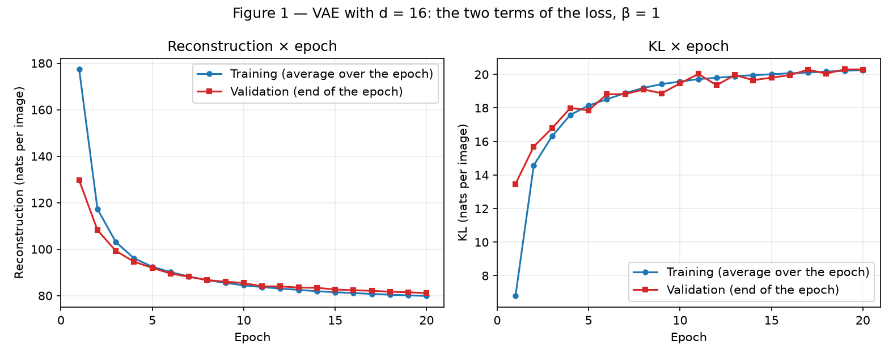
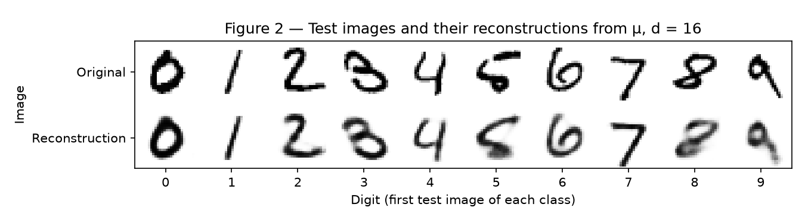
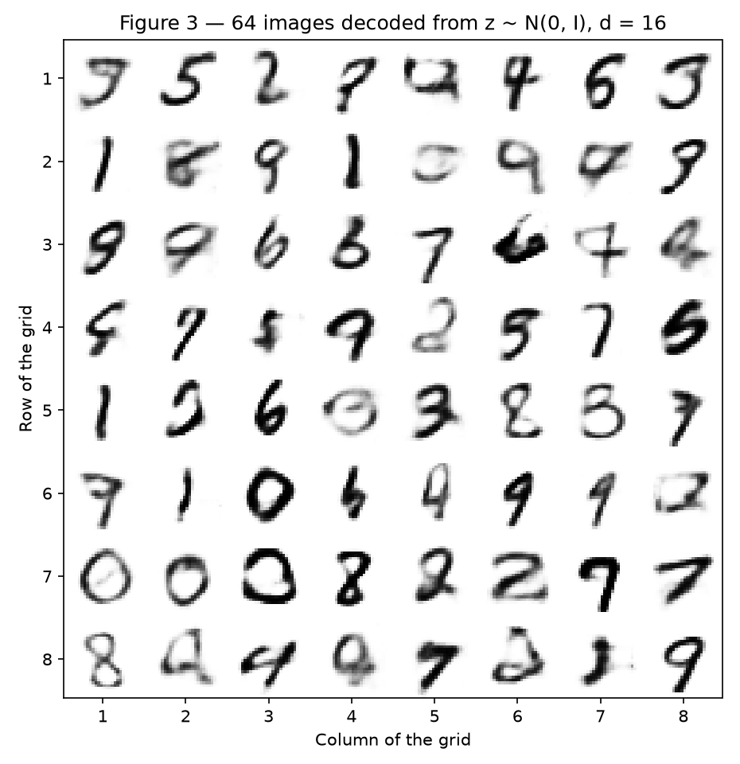
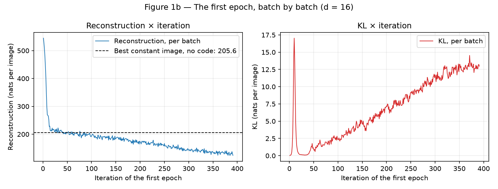
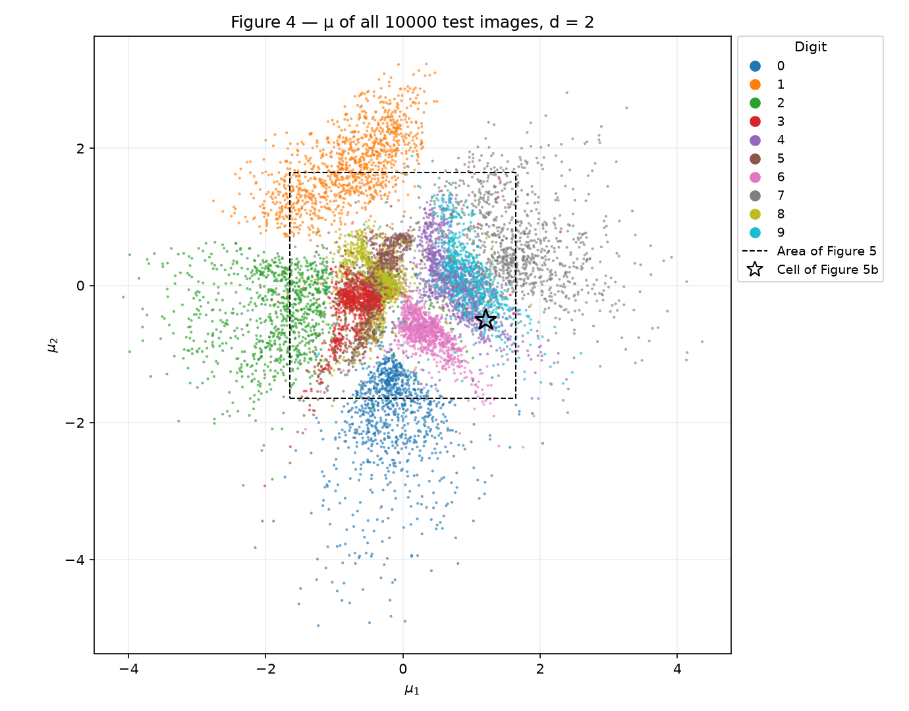
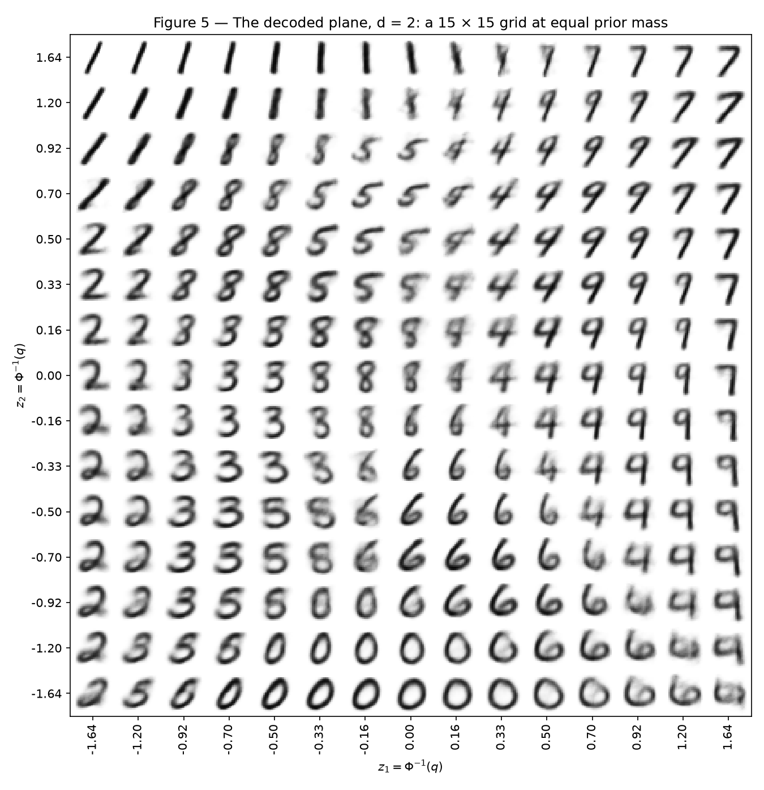
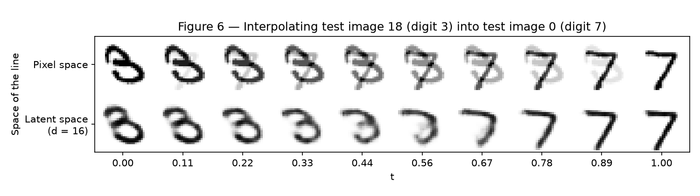
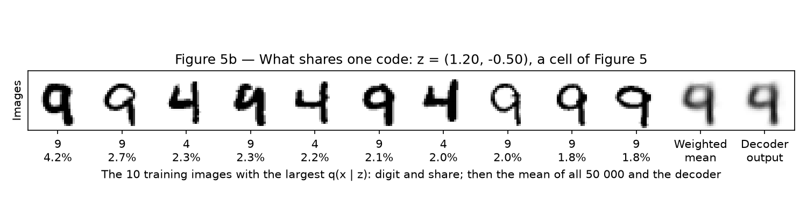
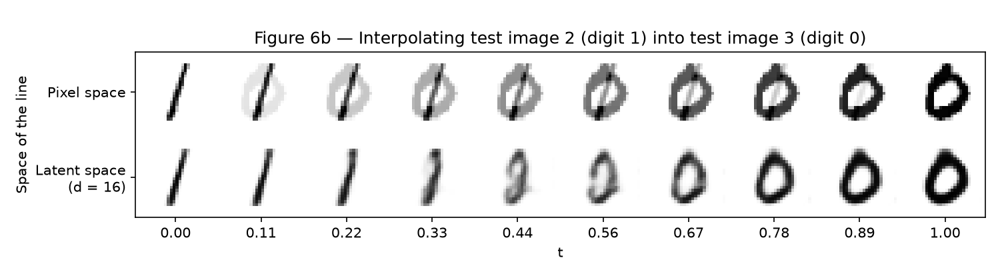

# 4. VAE

!!! abstract "Enunciado"

    [Exercises → VAE](https://insper.github.io/ann-dl/){:target='_blank'}

!!! info "Reprodutibilidade"

    A divisão usa o gerador que o enunciado fixa, e `torch.manual_seed(42)` roda logo antes de cada
    modelo ser construído (dentro de `train_vae`). Rodando

    ```shell
    pip install -r requirements.txt
    python docs/exercises/vae/code/exercises.py
    ```

    a partir da raiz do repositório (cerca de 15 min numa CPU; o MNIST é baixado em `data/` uma vez),
    os números desta página são impressos e todas as figuras são regeradas em `figures/`. Os números
    foram obtidos com Python 3.12.10, PyTorch 2.15.0 (CPU), torchvision 0.29.2, NumPy 2.5.3, SciPy
    1.18.1, scikit-learn 1.7.2 e Matplotlib 3.11.2.

    O script fixa `torch.set_num_threads(1)`, porque o número de *threads* muda o arredondamento e, com
    ele, a trajetória do treino: repetir a execução dá pesos idênticos, mas com a mesma semente e 4 ou
    16 *threads* (basta trocar esse valor no script) a rede de $d = 16$ termina com reconstrução de 81,74
    ou 81,81 no teste, contra 80,41 aqui. Uma CPU com outro conjunto de instruções pode ter o mesmo efeito. Diferenças dessa ordem (1 a
    2 nats) não são resultado.

O fio condutor é o **cabo de guerra dentro da perda**. Um VAE paga por duas coisas: reconstruir a
entrada e manter o espaço latente perto de um *prior* do qual se possa amostrar. O Exercício 1 registra
os dois termos em separado e mostra por que vale a pena pagar KL. O Exercício 2 reduz o espaço latente a
duas dimensões, para ver o que o *prior* compra e quanto custa.

---

## Abordagem de implementação

O código está dividido em dois arquivos, ambos em `code/`:

| Arquivo | Conteúdo |
|---------|----------|
| `vae.py` | Só o modelo: a classe `VAE`, a reparametrização, os dois termos da perda, a amostragem do *prior*, a avaliação e o laço de treino. |
| `exercises.py` | Os dados, a conferência das partes escritas à mão, os dois treinos, as Figuras 1–6 (e as auxiliares 1b, 5b e 6b), as medições da análise e a impressão de todo número citado aqui. |

Decisões de implementação que afetam os resultados:

| Decisão | Escolha | Por quê |
|---------|---------|---------|
| Termos em validação e teste | Um $\mathbf{z}$ sorteado por imagem, como no treino | É o que a ELBO define. Decodificar $\mu$ daria um número menor, que não é uma ELBO. |
| Ruído na avaliação | Um gerador próprio | Medir o modelo não altera o fluxo aleatório do treino. |
| Medições da análise | Na validação | O teste fica só para os números finais de cada modelo e para as Figuras 2, 4 e 6, onde o enunciado o coloca. |
| Dados | Uma matriz $N \times 784$ em memória | Só para não repetir `ToTensor()` a cada época; a divisão e a ordem não mudam. |
| Controles | As mesmas redes com $\beta = 0$ | Não são pedidos. Servem para separar o que é mérito do KL do que é mérito do decodificador. |

---

## Exercise 1

### A — Load and split the data

**Abordagem.** A divisão é a do enunciado, sem alteração.

``` { .python .copy .select linenums='1' title="docs/exercises/vae/code/exercises.py — dados" }
--8<-- "docs/exercises/vae/code/exercises.py:data"
```

| Conjunto | Imagens | Uso |
|---|---|---|
| Treino | 50 000 (primeiros índices sorteados: 37542, 43087, 2992, 25810, 39634) | Pesos |
| Validação | 10 000 | Os dois termos em cada época e as medições da análise |
| Teste | 10 000 (o conjunto oficial) | Só depois do treino: números finais e Figuras 2, 4 e 6 |

Os pixels estão em $[0, 1]$: 81,54% valem exatamente 0 ou 1 e 8,66% estão em $(0{,}1;\ 0{,}9)$, o que
justifica o modelo de Bernoulli do enunciado.

### B — Build the model

**Arquitetura.** A do enunciado, com $d = 16$: 1 079 600 parâmetros.

``` { .python .copy .select linenums='1' title="docs/exercises/vae/code/vae.py — modelo" }
--8<-- "docs/exercises/vae/code/vae.py:model"
```

**Reparametrização e os dois termos da perda**, escritos à mão:

$$
\mathbf{z} = \mu + \sigma \odot \epsilon, \quad \epsilon \sim \mathcal{N}(0, I);
\qquad
L = \underbrace{-\sum_{j=1}^{784} \left[x_j \log \hat{x}_j + (1 - x_j)\log(1 - \hat{x}_j)\right]}_{\text{reconstrução}}
+ \beta\, \underbrace{\tfrac{1}{2}\sum_{i=1}^{d}\left(\mu_i^2 + \sigma_i^2 - 1 - \log \sigma_i^2\right)}_{\text{KL}}
$$

com $\beta = 1$ e a média sobre as imagens do lote. A amostragem é `sample_prior`: sorteia
$\mathbf{z} \sim \mathcal{N}(0, I)$ e decodifica.

``` { .python .copy .select linenums='1' title="docs/exercises/vae/code/vae.py — reparametrização, perda e amostragem" }
--8<-- "docs/exercises/vae/code/vae.py:loss"
```

**Conferência.** Antes de confiar em qualquer número, o script confere as três peças escritas à mão contra
as suas definições:

``` { .python .copy .select linenums='1' title="docs/exercises/vae/code/exercises.py — conferência das partes escritas à mão" }
--8<-- "docs/exercises/vae/code/exercises.py:checks"
```

| Peça | Conferência | Resultado |
|---|---|---|
| Reconstrução | `reconstruction_term` contra a fórmula do enunciado, escrita por extenso | 781,774294 nos dois |
| Soma, não média | `reduction="mean"` × 784 | 781,774294: é o fator que viraria um $\beta \approx 784$ escondido |
| KL | Vale 0 em $\mu = 0$, $\log\sigma^2 = 0$ | 0,000000 |
| KL | Forma fechada contra Monte Carlo de $\mathbb{E}_q[\log q(\mathbf{z}) - \log p(\mathbf{z})]$ | 9,7990 contra 9,8019 (erro-padrão 0,0033) |
| Reparametrização | O autograd contra $\partial z/\partial\mu = 1$ e $\partial z/\partial\log\sigma^2 = \tfrac{1}{2}\sigma\epsilon$ | Diferença máxima: 0 |

### C — Train

**Abordagem.** Adam, $\eta = 10^{-3}$, lotes de 128, 20 épocas, registrando os dois termos em treino e validação.

``` { .python .copy .select linenums='1' title="docs/exercises/vae/code/vae.py — laço de treino" }
--8<-- "docs/exercises/vae/code/vae.py:train"
```

| Época | Reconstrução, treino | KL, treino | Reconstrução, validação | KL, validação | Total, validação |
|---|---|---|---|---|---|
| 1 | 177,33 | 6,79 | 129,56 | **13,47** | 143,03 |
| 2 | 117,23 | 14,58 | 108,20 | 15,70 | 123,90 |
| 3 | 103,10 | 16,31 | 99,26 | 16,79 | 116,04 |
| 4 | 96,05 | 17,59 | 94,59 | 18,00 | 112,59 |
| 5 | 92,44 | 18,14 | 91,95 | 17,86 | 109,80 |
| 10 | 84,45 | 19,57 | 85,42 | 19,46 | 104,88 |
| 15 | 81,48 | 20,00 | 82,66 | 19,80 | 102,46 |
| 20 | 79,86 | 20,26 | 81,05 | **20,29** | 101,35 |

**Resultado no teste, em nats por imagem:** reconstrução **80,41**, KL **20,32**, ELBO negativo **100,73**,
em linha com a referência do enunciado (cerca de 81 e 20). O sorteio de $\mathbf{z}$ na avaliação pesa pouco:
com cinco outros sorteios, a reconstrução fica entre 80,39 e 80,57.


/// caption
**Figura 1** — Os dois termos da perda por época. A curva de treino é a média ao longo da época, com os pesos
mudando; a de validação é medida no fim. Por isso, na época 1, a validação parece "melhor" que o treino: a média
de treino inclui as primeiras iterações. A partir da época 8 a ordem se inverte na reconstrução, e na época 20 a
folga é de 1,19 nat (79,86 contra 81,05).
///

### D — Reconstructions and samples

A Figura 2 usa a primeira imagem de teste de cada dígito (índices 3, 2, 1, 18, 4, 8, 11, 0, 61 e 7) e decodifica
$\mu$, sem sortear nada: `model.decode(model.encode(originais)[0])`. A Figura 3 é `torch.manual_seed(0)` seguido de
`sample_prior(model, 64)`.


/// caption
**Figura 2** — Em cima, a primeira imagem de teste de cada dígito; embaixo, a reconstrução a partir de $\mu$. A
identidade e o estilo geral (a inclinação, o traço do 7) sobrevivem, mas os traços ficam mais macios. O 8 e o 5 são
os que mais perdem forma.
///


/// caption
**Figura 3** — 64 imagens decodificadas de $\mathbf{z} \sim \mathcal{N}(0, I)$. Muitas são dígitos legíveis, mais
macios que os da Figura 2; outras não parecem dígito nenhum, como as de (linha, coluna) (2, 2), (2, 5), (3, 8) e (8, 6).
///

### E — Analysis

**Por que o otimizador paga mais KL.** Porque ele minimiza a soma, e o KL é o preço de o código dizer alguma coisa
sobre a imagem. Na validação, entre a primeira e a última época, o KL **sobe** de 13,47 para 20,29 enquanto o total
**cai** de 143,03 para 101,35.

Sem informação em $\mathbf{z}$, o decodificador não tem como distinguir as imagens: o melhor que ele pode fazer é
devolver sempre a média do treino, que dá reconstrução de 205,60 na validação, com KL 0. A Figura 1b mostra a rede
passando por esse patamar: depois de um transiente (pico de KL de 17,04 na iteração 10), entre as iterações 21 e 40 ela
tem reconstrução de 212,31 e KL de 0,15. Daí em diante, pôr informação no código compensa. Ainda na primeira época, entre as
iterações 41–60 e 372–391, o KL passa de 1,12 para 12,92 e a reconstrução de 203,97 para 131,40: 11,80 nats pagos,
72,57 economizados. Da imagem constante até a época 20, são 124,55 economizados e 20,29 pagos, **6,14 por nat**.


/// caption
**Figura 1b** — A primeira época, lote a lote (figura auxiliar). A reconstrução chega ao patamar da imagem média quase
sem KL, e o KL só começa a subir de forma sustentada depois disso.
///

Essa conta é uma média, não o preço do último nat, e mistura o ganho da informação com o decodificador melhorando ao
mesmo tempo. Com $\beta = 1$, pagar mais deixa de compensar quando o próximo nat devolve só um nat de reconstrução. Por isso
o KL não sobe para sempre: a partir da época 10 ele quase para (19,46 na época 10, 20,29 na época 20), embora a reconstrução
siga caindo (de 85,42 para 81,05).

**Por que a Figura 3 é pior que a Figura 2. Razão 1: onde as amostras do *prior* caem.** Os códigos das imagens têm a
variância do *prior*, mas não a sua forma. A variância agregada de cada dimensão, $\text{Var}[\mu_i] + \mathbb{E}[\sigma_i^2]$,
está entre 0,97 e 1,09, tal como a do *prior*, mas a nuvem é agrupada por dígito: um *k-NN* ($k = 15$) lê o dígito a partir de
$\mu$ com 96,51% de acerto. $\mathcal{N}(0, I)$ é uma única bolha, e muitas das suas amostras caem **entre os grupos**, onde o
decodificador produz algo intermediário, ou nenhum dígito.

O teste é alimentar **o mesmo decodificador** com códigos de origens diferentes:

``` { .python .copy .select linenums='1' title="docs/exercises/vae/code/exercises.py — códigos de várias origens" }
--8<-- "docs/exercises/vae/code/exercises.py:codesets"
```

Para comparar os conjuntos de imagens, o script treina um classificador de dígitos pequeno (`[784, 256, 10]`, 5 épocas, 96,96%
na validação) e conta as imagens em que a sua probabilidade máxima fica abaixo de 0,9. Ele serve para comparar conjuntos de
imagens decodificadas, não como juízo absoluto de "é um dígito".

| Origem (2000 imagens, $d = 16$) | Prob. máxima < 0,9 | Pixels cinza por imagem |
|---|---|---|
| Imagens reais, sem decodificar | 9,4% | 67,3 |
| $\mathbf{z} = \mu$ (como na Figura 2) | 9,7% | 113,1 |
| $\mathbf{z} \sim q(\mathbf{z} \mid \mathbf{x})$ | 11,1% | 113,6 |
| Uma gaussiana por dígito | **16,9%** | 118,0 |
| Uma gaussiana ajustada a todos os códigos | 46,8% | 129,3 |
| **$\mathcal{N}(0, I)$ (como na Figura 3)** | **48,6%** | **131,1** |

Acertar a variância e as correlações quase não ajuda (46,8% contra 48,6%), e sortear de dentro de um grupo resolve a maior parte
(16,9%). O problema, portanto, não é a escala: é a estrutura em grupos. Na grade da própria Figura 3, 32 de 64 imagens ficam abaixo de
0,9 e 4 de 64 abaixo de 0,5. O KL é o que traz o *prior* para perto dos códigos: sem ele ($\beta = 0$), a variância agregada fica
entre 8,68 e 18,82, e 99,6% das amostras do *prior* ficam abaixo de 0,9.

**Razão 2: o que o decodificador devolve para um dado $\mathbf{z}$.** A saída não é uma imagem sorteada do modelo: é a **média** de
$p(\mathbf{x} \mid \mathbf{z})$, uma probabilidade por pixel. Para um $\mathbf{z}$ fixo, a BCE esperada é mínima em
$\hat{x}_j = \mathbb{E}[x_j \mid \mathbf{z}]$. Como diz a seção da aula sobre o borrão, se várias imagens nítidas são compatíveis com um
código, a saída ótima é a média delas, e médias de imagens são borradas. A Figura 5b mostra essa média diretamente, em $d = 2$.

Essa razão vale nas duas figuras: mesmo em $\mathbf{z} = \mu$, os pixels cinza sobem de 67,3 nas imagens reais para 113,1. E parte desse cinza é
indecisão: dos 113,9 pixels cinza da saída (em toda a validação), 59,0 são cinza também na imagem real, as bordas do traço, e **54,8 são quase
pretos ou brancos na imagem real**. As duas razões se combinam assim: a razão 2 explica por que nada, nas duas figuras, é nítido; a razão 1
explica o que a Figura 3 tem a mais, os não-dígitos e o borrão extra (131,1 pixels cinza no *prior* contra 113,6 em $q$, com o mesmo decodificador).

**Por que decodificar $\mu$ na Figura 2.** Porque a figura pergunta o que o modelo guardou **desta** imagem, e $\mu$ é a resposta: o centro de
$q(\mathbf{z} \mid \mathbf{x})$, um único código por imagem, sem sorteio. O ruído $\sigma\epsilon$ existe para treinar e para estimar a ELBO, não para
descrever a imagem, e ele não é pequeno. Na validação, dois sorteios de $\mathbf{z}$ para a mesma imagem decodificam para imagens a 1,82 de distância
uma da outra (norma euclidiana, em média), contra 2,85 entre a imagem original e a decodificação de $\mu$. Sortear também piora o resultado: a
reconstrução é de 75,57 nats com $\mu$ e 81,05 com $\mathbf{z}$ sorteado, pior em 94,8% das imagens.

---

## Exercise 2

### A — Train a 2-D VAE

**Abordagem.** O mesmo `train_vae`, trocando só $d$: `train_vae(2, x_train, x_val)`. Mesmos dados, semente, $\beta$ e orçamento; 1 068 820 parâmetros.

| No teste, nats por imagem | Reconstrução | KL | ELBO negativo |
|---|---|---|---|
| $d = 16$ | 80,41 | 20,32 | 100,73 |
| **$d = 2$** | **133,92** | **6,76** | **140,67** |
| Diferença | +53,51 | −13,56 | +39,94 |

Em linha com a referência (cerca de 135 e 7). Como a BCE destas imagens tem um **piso** de 45,54 nats no teste (a entropia dos pixels cinza, que nem uma
reconstrução perfeita elimina), o custo é mais bem lido acima dele: 34,87 nats com $d = 16$ contra 88,38 com $d = 2$.

### B — The encoded test set


/// caption
**Figura 4** — $\mu$ de todas as 10 000 imagens de teste, em ordem de desenho aleatória, para nenhum dígito ficar escondido sob os outros. O quadrado
tracejado é a área coberta pela Figura 5: 24,48% dos pontos ficam fora dele, contra 19% sob o *prior*. A estrela marca a célula da Figura 5b.
///

### C — The decoded plane

``` { .python .copy .select linenums='1' title="docs/exercises/vae/code/exercises.py — a grade da Figura 5" }
--8<-- "docs/exercises/vae/code/exercises.py:grid"
```


/// caption
**Figura 5** — O plano decodificado, com as linhas de cima no maior $z_2$, para casar com os eixos da Figura 4. As células são mais próximas no centro,
onde o *prior* concentra massa (passo de 0,16), e mais distantes nas pontas (0,44).
///

**Por que a massa é a mesma:** como $\Phi(z) = q$, a massa do *prior* entre duas linhas vizinhas da grade é $\Phi(z_{k+1}) - \Phi(z_k) = q_{k+1} - q_k = 0{,}0643$ em
cada eixo, e como as coordenadas são independentes sob $\mathcal{N}(0, I)$, toda célula do plano tem a mesma massa, $0{,}0643^2 = 0{,}0041$.

### D — Interpolation

**Índices interpolados: $a = 18$ (dígito 3) e $b = 0$ (dígito 7)**, o primeiro 3 e o primeiro 7 da Figura 2, escolhidos a olho entre alguns candidatos de formas
bem diferentes. Por isso o item E repete a medida em 500 pares sorteados e mostra um contraexemplo.

``` { .python .copy .select linenums='1' title="docs/exercises/vae/code/exercises.py — as duas interpolações" }
--8<-- "docs/exercises/vae/code/exercises.py:interpolate"
```


/// caption
**Figura 6** — Em cima, a reta no espaço de pixels: uma dupla exposição, com o 3 desaparecendo enquanto o 7 aparece, os dois visíveis ao mesmo tempo. Embaixo, a reta
entre os códigos do modelo de $d = 16$: um único traço que se deforma, com o arco de cima do 3 virando a barra do 7 e o arco de baixo sumindo.
///

### E — Analysis

**Quais dígitos se sobrepõem.** Na Figura 4, principalmente 4 com 9 e o trio 3, 5 e 8. Para medir, um *k-NN* ($k = 15$) ajustado nos $\mu$ de treino classifica os pontos
da figura. Ele acerta 81,60%, e os 1840 erros se concentram em poucos pares:

| Par | Confusões (nos dois sentidos) | Distância entre os centroides |
|---|---|---|
| **4 e 9** | **586** | 0,18 |
| 5 e 8 | 278 | 0,19 |
| 3 e 5 | 227 | 0,36 |
| 3 e 8 | 114 | |
| 7 e 9 | 114 | |

Para comparação, os centroides de 0 e 1 estão a 3,71. Na figura, 4 e 9 formam duas faixas alongadas e paralelas, sobrepostas numa diagonal que vai de cerca de
$(0{,}6;\ 1{,}3)$ até $(1{,}4;\ -0{,}9)$, e 3, 5 e 8 se empilham à esquerda do centro. Os pares fazem sentido visualmente: 4 e 9 diferem em fechar ou não o topo, e 3, 5 e 8
diferem em quais lados das duas curvas estão fechados.

**Na Figura 5, a mesma transição é a diagonal entre as colunas de 4 e de 9.** Medindo, em cada célula, a fração de cada dígito entre as imagens de treino que compartilham aquele
código, 18 células têm 4 e 9 com pelo menos 25% cada. Na linha $z_2 = 0$, o 4 de topo aberto em $z_1 = 0{,}33$ vira o 9 de laço redondo em $z_1 = 1{,}20$. **As imagens intermediárias**
($z_1 = 0{,}50$ e $0{,}70$; nesta última, 49% e 42% do peso são de 4 e 9) têm a mesma haste vertical, que os dois dígitos compartilham, e uma barra cinza fechando o topo pela
metade: não são um 4 nem um 9, nem dois dígitos sobrepostos, porque só a parte em que eles discordam fica indecisa. Do lado esquerdo, a transição do trio tem o mesmo aspecto: na linha
$z_2 = 0{,}16$, o 3 de $z_1 = -0{,}92$ ganha arcos cinza à esquerda até virar o 8 de $z_1 = -0{,}33$.

A Figura 5b mostra uma célula dessas por dentro. Na mais misturada de 4 e 9, $\mathbf{z} = (1{,}20;\ -0{,}50)$, 46,4% do peso é de 4 e 50,8% é de 9. A média das 50 000 imagens de treino,
ponderada por $q(\mathbf{x} \mid \mathbf{z})$, fica a 0,77 da saída do decodificador, enquanto a mais próxima das dez imagens de maior peso fica a 4,46.


/// caption
**Figura 5b** — As dez imagens de treino que mais pesam num único código (figura auxiliar): 4 e 9 misturados, de traço grosso e fino, que respondem por 23,3% do peso. À direita, a média
ponderada de todas e a saída do decodificador, quase a mesma imagem, com o topo do laço em meio-tom.
///

**O que dois números obrigam a jogar fora.** Dois números e um decodificador suave formam uma folha de duas dimensões em $\mathbb{R}^{784}$: códigos vizinhos têm de dar imagens parecidas, e cada
lugar do plano tem uma única imagem. Todos os dígitos e todos os estilos precisam caber nessa folha, e o que não cabe se perde. Medindo, dentro de cada dígito, o quanto a reconstrução acompanha a
imagem real:

| Nas 10 000 imagens de validação, reconstruindo de $\mu$ | $d = 16$ | $d = 2$ |
|---|---|---|
| Erro quadrático por imagem | 8,88 | 28,43 |
| Variância **dentro do dígito** explicada | 78,7% | **31,8%** |
| Correlação da inclinação, dentro do dígito | 0,990 | 0,900 |
| Correlação da quantidade de tinta (aproxima a espessura do traço), dentro do dígito | 0,990 | **0,559** |
| Acurácia do *k-NN* a partir de $\mu$ | 96,51% | 81,30% |

Os dois números guardam a identidade grosseira do dígito e a inclinação, e jogam fora **a maior parte da variação dentro do dígito** (68% da variância), **boa parte da espessura do traço e parte da
própria identidade**, as distinções finas como 4 contra 9.

**A Figura 5 é a evidência.** Andar pelo plano é a única forma de variar o estilo, e essa variação acontece junto com a troca de dígito. A inclinação coube: nas duas primeiras linhas, os 1 giram
continuamente de $z_1 = -1{,}64$ até $z_1 = 0$, e, medindo as próprias células, separadas por classe, o desvio da inclinação é quase o real (0,228 contra 0,261). A tinta coube bem menos: 16,28 contra
27,47. E nenhuma célula é tão nítida quanto uma imagem original. A Figura 5b mostra os dois efeitos juntos: dez imagens de traços bem diferentes para um só código, e uma única saída de traço médio.

**O limite é a folha, não o KL.** O KL baixo de $d = 2$ poderia parecer a causa, mas o controle sem KL mostra que não é:

| Modelo | KL (teste) | Reconstrução (teste) | Erro quadrático de $\mu$ (validação) |
|---|---|---|---|
| $d = 2$, $\beta = 1$ | 6,76 | 133,92 | 28,43 |
| $d = 2$, $\beta = 0$ | 77,03 | 132,69 | 28,18 |
| $d = 16$, $\beta = 0$ | 302,96 | 67,15 | 6,36 |

Sem KL, o código pode ser mais de 11 vezes mais caro, e a reconstrução quase não muda (de 133,92 para 132,69). Nos dois números não cabe mais do que isso, com ou sem KL. O KL baixo é consequência: de nada
adianta um código mais preciso que o decodificador não consegue aproveitar. Sem KL em nenhum dos dois, ir de $d = 2$ para $d = 16$ ainda vale 65,54 nats: é o custo das dimensões que faltam.

**Qual linha da Figura 6 passa por dígitos.** A de baixo, a do espaço latente: cada quadro é um único traço, que se deforma do 3 ao 7 (o classificador dá de 0,81 a 1,00 de probabilidade máxima nos dez quadros).
A de cima é uma dupla exposição.

**Por que a de pixels não passa.** A interpolação é linear **nos pixels**: o quadro é a soma ponderada das duas imagens, então nenhum traço pode se mover, só apagar enquanto outro acende. Os dígitos ocupam uma
superfície fina e curva em $\mathbb{R}^{784}$, e a corda entre dois pontos de uma superfície curva sai dela. **Por que a latente passa.** A reta é nos códigos, e o decodificador é não linear: a reta vira uma curva
em pixels, que desloca e deforma o traço em vez de misturar duas imagens.

Os números descrevem isso, e em boa parte são a própria aritmética: no ponto médio em pixels, um pixel aceso numa só das imagens vale 0,5, então a área de tinta é a união das duas e só as sobreposições passam de 0,5.
O resultado não depende da escolha do par. Em 500 pares de dígitos diferentes, sorteados na validação:

| 500 pares | Área de tinta (> 0,2) | Traço forte (> 0,6) |
|---|---|---|
| Imagens reais | 125,0 | 93,7 |
| Suas reconstruções | 135,3 | 91,7 |
| **Pontos médios em pixels** | **182,1** | 43,9 |
| **Pontos médios latentes** | **135,3** | 68,7 |

O ponto médio latente tem a área de tinta de uma reconstrução (135,3 nos dois casos), embora perca traço forte (68,7 contra 91,7): é um traço só, mais borrado. E quem elimina a dupla exposição é o decodificador, não o KL:
no controle com $\beta = 0$, o ponto médio latente também é um traço só (área de 137,6), o que não mostra ganho do KL na interpolação, numa única semente. Onde o KL faz diferença grande é na amostragem.

**A latente não garante um dígito.** Na Figura 6b, a reta de um 1 a um 0 (índices 2 e 3) passa, em $t = 0{,}44$ e $0{,}56$, por um rabisco com probabilidade máxima de só 0,37 e 0,24, contra 0,94 ou mais nos outros quadros. E nos
500 pares, 53,8% dos pontos médios latentes ficam abaixo de 0,9, contra 7,6% das reconstruções (parte disso é ambiguidade legítima, pois um ponto entre dois dígitos pode ser mesmo um meio-termo).


/// caption
**Figura 6b** — O contraexemplo (figura auxiliar): do primeiro 1 ao primeiro 0 da Figura 2. Mesmo na linha latente, os quadros do meio não são um dígito.
///

---

## Discussão

**O que o *prior* compra e quanto custa.** Em $d = 16$, tirar o KL melhora a reconstrução em 13,26 nats (67,15 contra 80,41), mas tira o *prior* da escala dos códigos: o classificador fica abaixo de 0,9 em 99,6% das amostras,
contra 48,6%. A interpolação quase não muda.

**Limites das medidas.** As figuras e as tabelas vêm de uma semente, a do enunciado. O classificador foi treinado em imagens reais e é aplicado a imagens borradas: os valores absolutos dependem dele, e só as comparações entre
conjuntos decodificados interessam.

**Conclusão.** O otimizador paga KL porque um código informativo devolve bem mais reconstrução do que custa, e 6,14 nats por nat em média. Esse pagamento produz um espaço de onde se pode amostrar, mas não perfeito: as amostras
do *prior* caem também entre os grupos de dígitos, e o decodificador devolve médias. Com duas dimensões, o espaço fica visível, ao custo de 53,51 nats de reconstrução e da maior parte da variação dentro de cada dígito, um limite das
dimensões, e não do KL.

---

## Results summary

| # | Quantity | Value |
|---|----------|-------|
| 1 | Ex. 1 — test reconstruction, KL and negative ELBO ($d = 16$) | Reconstrução **80,41** · KL **20,32** · ELBO negativo **100,73** nats por imagem |
| 2 | Ex. 1 — validation KL at the first and at the last epoch | **13,47** na época 1 · **20,29** na época 20 |
| 3 | Ex. 2 — test reconstruction and KL ($d = 2$) | Reconstrução **133,92** · KL **6,76** nats por imagem |
| 4 | Ex. 2 — the two test indices interpolated | **18** (dígito 3) e **0** (dígito 7) |
